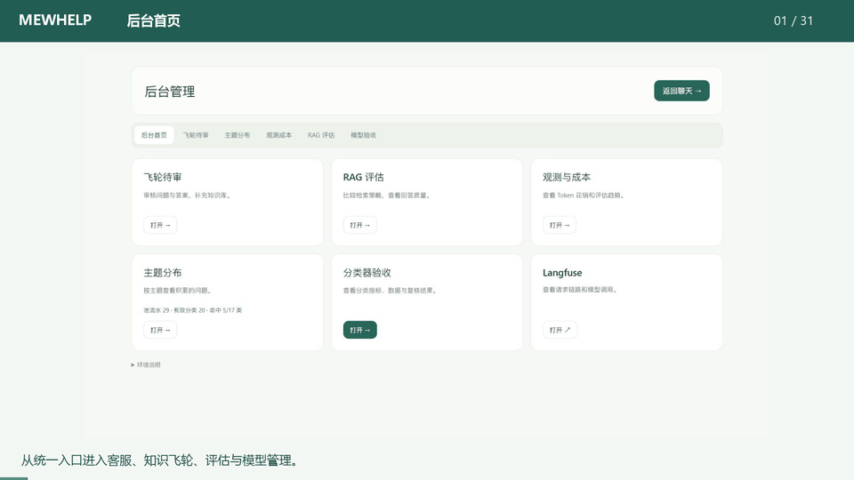
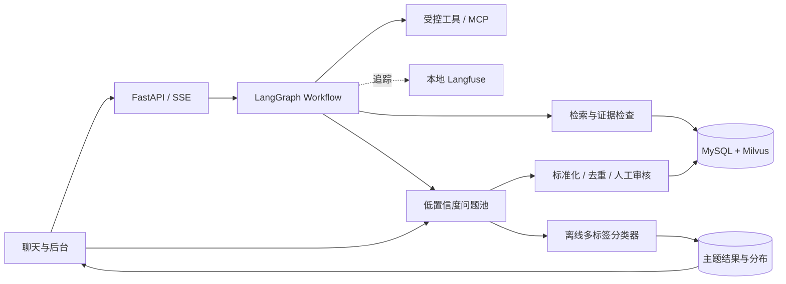

# MewHelp · EcomAssist

[](pyproject.toml)
[](app/main.py)
[](compose.yaml)
[](pyproject.toml)
[](app/workflow/)
[](app/retrieval/)
[](compose.milvus.yaml)
[](ml/topic_classifier/)
[](compose.yaml)
[](LICENSE)

**从流式对话、RAG 和工具调用，到可观测的数据飞轮与多标签模型训练。**

基于 Python、FastAPI 和 LangGraph 的电商智能客服工程。它把知识检索、业务流程、人工确认、评估和离线改进串起来，并保留每一步的需求、设计、开发过程与实测结果，适合学习、研究和本地功能演示。

[快速开始](docs/getting-started.md) · [文档导航](docs/README.md) · [系统架构](docs/architecture.md) · [主题分类器](docs/topic-classifier.md) · [参与贡献](CONTRIBUTING.md)

## 页面演示

**2 分 11 秒看全部页面**：聊天、后台、飞轮待审、观测成本、RAG 评估、主题分布、分类器验收及样本审核。下方动态导览包含全部31个镜头，也可下载MP4播放。

[](https://github.com/beemines/EcomAssist/raw/refs/heads/master/docs/assets/pages-walkthrough.mp4)

[下载 MP4](https://github.com/beemines/EcomAssist/raw/refs/heads/master/docs/assets/pages-walkthrough.mp4) · [仓库内视频](docs/assets/pages-walkthrough.mp4) · [章节与页面清单](docs/demo-video.md) · [静态预览](docs/assets/admin-overview.png)

实际页面画面剪辑，含无声字幕；历史原话区域已裁剪，真实指标与当前未就绪状态保留。

## 能做什么

| 能力 | 实现 |
| --- | --- |
| 多轮客服对话 | SSE 流式输出、停止生成、历史会话、摘要与分层上下文预算 |
| 知识问答 | Markdown 入库、Dense + BM25 双路召回、RRF 融合、重排与逐条来源引用 |
| 受控业务处理 | 意图路由、LangGraph Workflow、有限步 Agent、订单选择与工单/退款确认 |
| 可插拔工具 | 本地工具与独立 MCP Server、动态发现、统一策略、调用预算与审计 |
| 观测与评估 | 自部署 Langfuse trace、按意图统计 Token、四策略 RAG 评估、指标趋势与置信度校准 |
| 数据飞轮 | 低检索置信度、模型自评不足和用户 👎 三路入池，快照留证、标准化去重、人工审核后补库 |
| 自有主题模型 | HFL RoBERTa-wwm-ext 全参数微调、17 类多标签评测、CPU 推理服务、旁路批量归类与主题分布 |

订单、商品和物流等工具使用演示数据；工单和退款申请可真实持久化，须经过页面确认，退款申请不执行资金退款。主题模型运行在离线旁路，实时聊天不调用它。

## 快速开始

### 1. 安装应用依赖

准备 Python **3.11–3.13**、[uv](https://docs.astral.sh/uv/) 和 Docker Compose。以下为 PowerShell 命令，在仓库根目录执行：

```powershell
git clone https://github.com/beemines/EcomAssist.git
Set-Location EcomAssist
uv sync --locked
if (-not (Test-Path -LiteralPath '.env')) { Copy-Item .env.example .env }
```

在 `.env` 中填写模型服务与数据库配置。安装依赖不会自动准备知识库、训练权重或历史验收产物。

### 2. 准备数据库与知识库

```powershell
docker compose -p ecs-tool-calling --profile test up -d --wait --wait-timeout 120
docker compose -f compose.milvus.yaml -p ecs-knowledge up -d
```

继续按[首次部署指南](docs/getting-started.md)完成显式迁移、知识导入与检索校准。应用启动只核验结构；已有数据卷不会因启动而自动升级。更换语料或重排模型后需要重新校准，不能照抄历史报告里的门槛。

### 3. 启动客服

完成前置准备后：

```powershell
uv run --locked uvicorn app.main:create_app --factory --host 127.0.0.1 --port 8000 --workers 1
```

打开 [聊天页](http://127.0.0.1:8000/) 或 [后台首页](http://127.0.0.1:8000/admin)。当前会话互斥与任务归属采用单进程约束，保持一个 worker。可选模块的配置与演示见[文档导航](docs/README.md)。

已有本项目私有验收材料时，可以按[第十步操作手册](docs/ch10-pycharm-acceptance.md)启动 8007 应用、8010 复核页及 8103 分类服务；这些端口和本机路径是验收配置，不是首次克隆的前置产物。

## 页面导航

| 路径 | 用途 |
| --- | --- |
| `/` | 聊天、历史、引用来源与反馈 |
| `/admin` | 后台统一入口 |
| `/review` | 飞轮待审、原话与检索证据、审核补库 |
| `/observability` | 意图成本、评估趋势、置信度校准 |
| `/rag-eval` | 检索策略对比、回答质量、逐题报告 |
| `/topics` | 17 类主题分布、筛选与问题明细 |
| `/topics/acceptance` | 分类器指标、语料血缘、训练与复核证据 |

页面和接口会显示模块未配置、数据不足或服务不可用等状态；打开页面不会自动训练分类器。费用评估、历史处理与批次执行需要各自的显式操作。

## 系统结构



详细模块边界、数据流和失败恢复见[系统架构](docs/architecture.md)。

## 技术栈

**客服业务数据库使用 MySQL 8.4**，Milvus 保存检索索引，SQLite 保存图检查点。下面只列客服应用、离线模型和开发工具直接使用的技术；[逐项核对依据](docs/technology-stack.md)列出源码、配置与验证范围。

| 层次 | 技术标签 |
| --- | --- |
| 后端与接口 | [](pyproject.toml) [](app/main.py) [](pyproject.toml) [](pyproject.toml) [](pyproject.toml) [](pyproject.toml) |
| 对话编排与工具 | [](pyproject.toml) [](app/workflow/) [](business_mcp/) [](pyproject.toml) |
| 业务存储与检查点 | [](compose.yaml) [](app/db/session.py) [](app/config.py) [](app/workflow/persistence.py) |
| 知识检索与重排 | [](compose.milvus.yaml) [](app/config.py) [](app/retrieval/) [](app/retrieval/) [](app/config.py) |
| 可观测性 | [](compose.langfuse.yaml) |
| 合成数据与预标 | [](app/topics/teacher.py) |
| 训练与推理 | [](ml/topic_classifier/doctor.py) [](ml/topic_classifier/pyproject.toml) [](ml/topic_classifier/pyproject.toml) [](ml/topic_classifier/pyproject.toml) [](ml/topic_classifier/pyproject.toml) |
| 数据处理与评测 | [](ml/topic_classifier/pyproject.toml) [](ml/topic_classifier/pyproject.toml) [](ml/topic_classifier/pyproject.toml) [](ml/topic_classifier/pyproject.toml) [](ml/topic_classifier/pyproject.toml) |
| 前端与流式交互 | [](app/static/) [](app/static/) [](app/static/) [](app/static/) |
| 部署与测试 | [](compose.yaml) [](uv.lock) [](pyproject.toml) [](pyproject.toml) |

<details>
<summary>自部署组件的内部依赖</summary>

这些是对应组件所需的基础设施，单独列在这里说明部署关系。

| 组件 | 内部依赖 | 核对配置 |
| --- | --- | --- |
| Langfuse | PostgreSQL 17、ClickHouse 25.12、Redis 7、独立 MinIO | [compose.langfuse.yaml](compose.langfuse.yaml) |
| Milvus | etcd 3.5.25、MinIO | [compose.milvus.yaml](compose.milvus.yaml) |

</details>

业务依赖由根目录 [`uv.lock`](uv.lock) 锁定；ML 环境使用独立的 [Python 3.12.13 配置与锁文件](ml/topic_classifier/pyproject.toml)，不把 Torch 装入业务虚拟环境。本项目当前导出为 **Transformers CPU 服务**，没有 ONNX 产物。

## 测试与质量证据

```powershell
# 默认回归：外部模型使用测试替身，真实存储测试默认跳过
uv run --locked python -m pytest -q

# 独立 ML 环境的合同与本地计算测试，不进行真实训练
uv sync --project ml/topic_classifier --locked
uv run --project ml/topic_classifier --locked python -m pytest ml/topic_classifier/tests -q
```

真实 MySQL、Milvus、Langfuse 测试须显式启用；准备方式见[开发与测试指南](docs/development.md)。离线回归通过不等于模型预测质量通过。

### 第十步当前模型

| 评测范围 | 样本数 | Macro-F1 | Micro-F1 | 全标签完全匹配 |
| --- | ---: | ---: | ---: | ---: |
| 完整合成银标测试 | 187 | 0.7672 | 0.7606 | 69/187 |
| 用户授权 AI 代审测试子集 | 67 | 0.7451 | 0.7426 | 28/67 |
| 主动选定的额外错例 | 34 | 0.5463 | 0.6429 | 5/34 |

“买大了想退”实际命中 **退换货 + 尺码**，固定诊断 8/8；实际问题池批次 20 条落表，重放新增 0 条。原池来源真实性尚未核实，不能称为 20 位真实客户的独立金标。当前整体泛化仍需改善，已知一对历史训练/验证近重复；本轮测试复核为 AI 代审，不冒充独立人工复核。完整分母、17 类矩阵和限制见[第十步交付报告](docs/superpowers/reports/2026-10-21-ch10-delivery.md)。

RAG 的历史 300 题四策略实验保留了 1,200 次尝试中的 1,188 次完成与 12 次错误；比较基于共同有效题集，见[分析报告](docs/validation/merchant-rag-comparison-analysis.md)。这些结果使用各自冻结的数据和配置，不与当前分类器指标混算。

## 目录

```text
app/
  api/           HTTP、SSE 和后台接口
  workflow/      图编排、状态与持久化
  retrieval/     改写、召回、融合与重排
  context/       分层上下文、摘要与预算
  tools/         工具契约、执行和策略
  flywheel/      问题标准化、审核与知识发布
  observability/ 本地追踪与成本统计
  topics/        分类数据、批次、统计和人审契约
  static/        聊天和后台页面
ml/topic_classifier/  独立训练、评测、导出与服务
evals/           冻结数据集及 RAG 评估
tests/           默认回归与显式存储集成
sql/             原始 DDL、运行扩展与种子
docs/            使用指南、步骤提示词、设计及报告
dev-notes/       逐阶段开发与返工记录
```

## 文档与贡献

- [文档总览与十步路线](docs/README.md)：从功能入口找到需求、实现和验收。
- [开发与测试](docs/development.md)：环境隔离、测试开关、提交检查。
- [贡献指南](CONTRIBUTING.md)：问题反馈、修改流程和 PR 说明。
- [安全说明](SECURITY.md)：本地部署边界、密钥、隐私与漏洞报告。
- [第十步原始提示词与 DDL](docs/prompts/step-10-topic-classifier.md) · [逐阶段记录](dev-notes/ch10.md)。

## 许可证与致谢

本项目采用 [MIT License](LICENSE)。模型、数据和第三方依赖的授权分别以各自项目为准。

感谢 FastAPI、LangChain / LangGraph、Milvus、Langfuse、MCP、HFL 中文预训练模型与 Hugging Face 等项目提供的基础能力。
