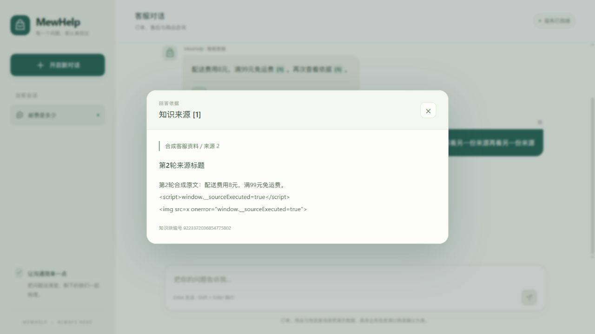
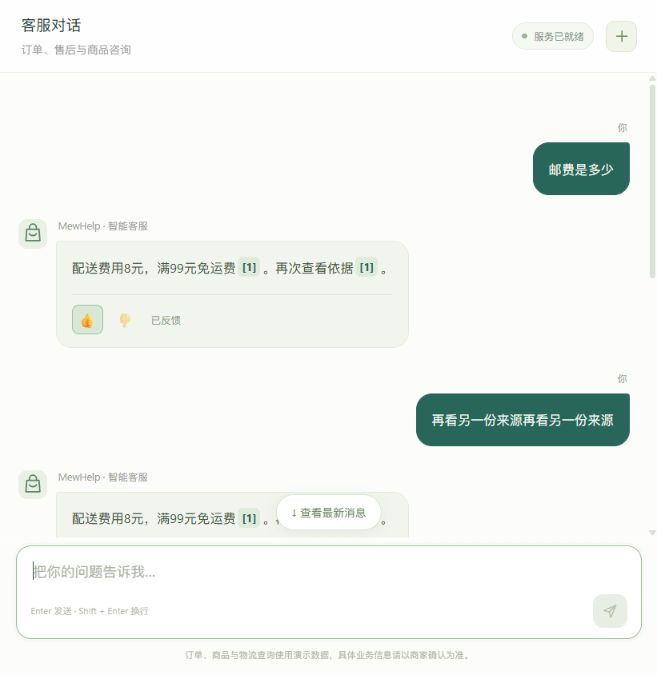
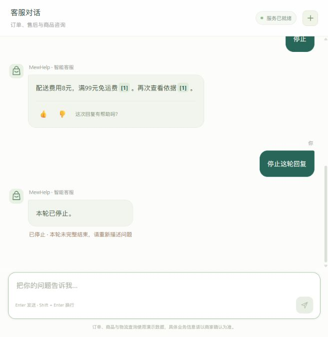
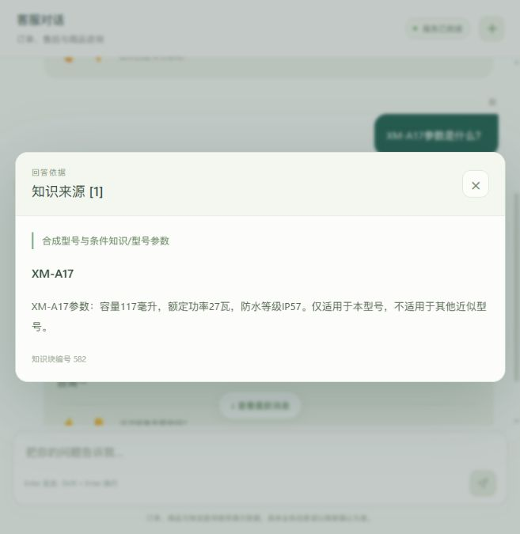
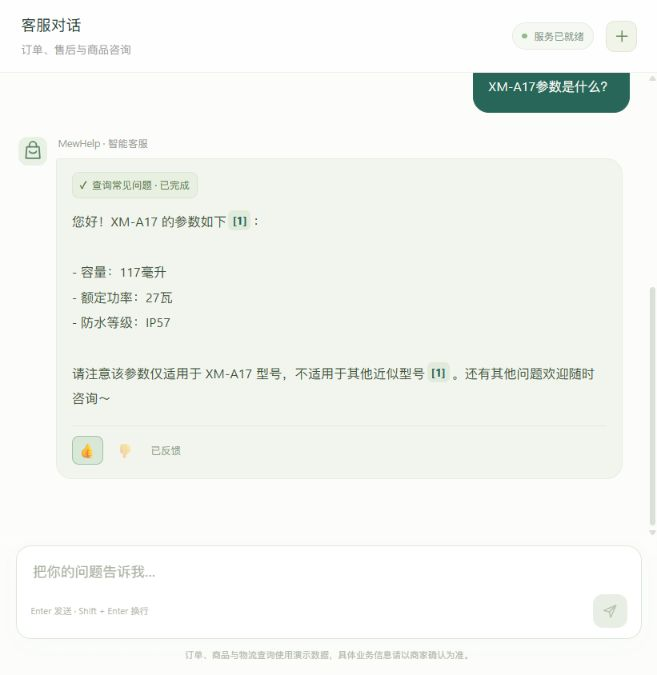

# 第四步聊天页交互验证

## 当前范围

2026-10-09，使用当前三份 `app/static` 文件和本轮专用 `127.0.0.1:8034` 受控 SSE 服务，在 Codex 内置浏览器实际操作。此阶段证明页面交互，**不代表真实模型、检索质量或数据库持久化已通过**。校准后的真实聊天验证将单独追加。

## 受控浏览器结果

| 操作 | 实际结果 |
| --- | --- |
| 回复把编号分成 `[`、`1`、`]` 三帧 | 形成可点击的 `[1]`；未完成的编号不提前生成按钮 |
| 两轮回复分别使用 `[1]`、随后再次打开第一轮 | 第一轮始终显示自己的来源，第二轮显示另一份来源 |
| 来源章节、问题、原文及 chunk 主键 | 面板全部显示；Escape 可以关闭 |
| 原文包含 `<script>` 和 `` 字面文本 | 保留原文，来源正文无子元素，没有创建脚本或图片元素 |
| 超出 JavaScript 安全整数的 ID | 会话 `18446744073709551614`、chunk `9223372036854775801/2` 保持完整十进制字符串 |
| 第一轮 👍、第二轮 👎 | 对应按钮点亮，显示“已反馈”，同组两个按钮均禁用，`aria-pressed` 与选择一致 |
| 点击两次反馈前后检查请求记录 | 只有一次创建会话和四次聊天 POST；反馈没有新增 POST |
| 新请求发送后立即停止 | 显示本轮未完整结束，不出现反馈按钮 |
| 控制台与窄屏布局 | 无控制台错误；窄屏气泡、来源面板与反馈仍可操作 |

一次取消操作因自动化到达时回复已完成，没有找到停止按钮；观察当前状态后对新的请求立即取消，得到上述取消结果。没有把已经完成的回复当作取消失败，也没有为此修改应用行为。

## 截图

来源原文及章节：

反馈点亮并锁定：

取消轮次不出现反馈：

## 检查与清理

`node --check app/static/chat.js`、`git diff --check` 均退出 0。按用户前端例外直接迭代，没有安排前端 TDD 或审查。DOM 交互检查只读取可见页面，反馈仅存页面状态。

预览服务未访问模型或数据库。只核实并停止本轮拥有的 uvicorn 进程 68588 及其子进程 73460；再次查询两 PID 均已退出。用户的 8000/8001 服务没有调整。

## 真实应用验证

随后在有效八题校准阈值 `0.8201608061790466` 下，专用 `127.0.0.1:8035` 当前应用连接 3308 测试库、本轮 84 条合成知识和唯一混合集合。使用真实 GLM/BGE/重排服务，最终回答仍 512，改写/自评 2048，改写60秒、自评20秒、零模型重试。

- 浏览器问 `XM-A17参数是什么？`，真实选择 `query_faq`，回复容量117毫升、功率27瓦和IP57，重复 `[1]` 两次均打开同一 chunk `582`，原文和章节路径与数据库正文一致。
- 实际回复的 👍 点亮，出现“已反馈”，同组两个按钮禁用。浏览器控制台无错误。AX 快照把切换按钮显示为 checkbox，但 DOM 是带 `aria-pressed` 的 button；依据实际 DOM 调整验收选择器，没有修改应用。
- TCP 请求“普通小件配送费多少？”并指定分类 `合成型号与条件知识`，67个增量，答8元/满99元包邮；多条件保修请求48个增量，答购买凭证/商品序列号；无线充电库外请求固定拒答，原话进入单条问题池。
- 三轮引用快照与实际保存的工具 JSON 完全一致，`done` 的会话/消息身份对应已提交的最终正文。完整事件时间、回答与审计见 [hybrid-chat-live.json](hybrid-chat-live.json)。

**保留失败观察：** 浏览器原话 `邮费是多少` 确实召回正确配送知识，第一条重排分 `.7018767595291138` 低于校准门槛，因而误拒答并入池。这一题没有算作质量通过；八题校准 F1=1 是样本内结果，不证明泛化。完整上游元数据和拥有资源记录见 [hybrid-ui-actual.json](hybrid-ui-actual.json)。其中计数钩子覆盖18次GLM调用和5次建库嵌入；主应用内部自建的在线嵌入/重排客户端未挂该钩子，不能把这两个计数冒充全部上游请求量。

通过本轮自有停止文件正常退出服务器，随后只读确认拥有的 messages/tickets/low_confidence_questions/conversations/knowledge_chunks 剩余均为0，唯一集合已不存在，编造台账保留。未调整业务3307和用户8000/8001。来源截图是当时实际证据快照；临时 chunk 在验收清理后不再留在测试库中。
