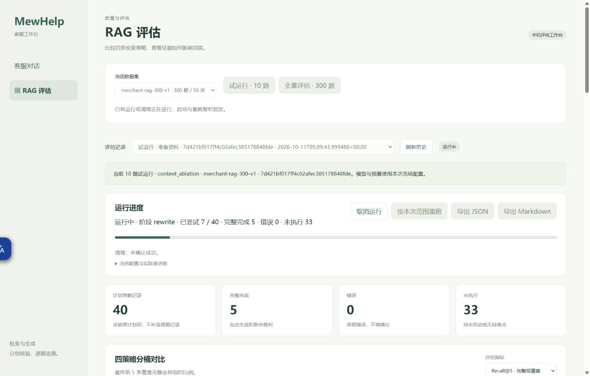
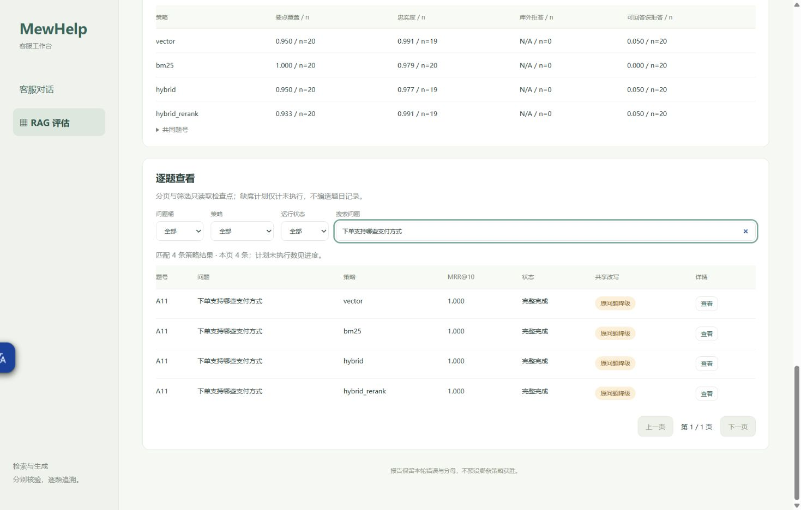
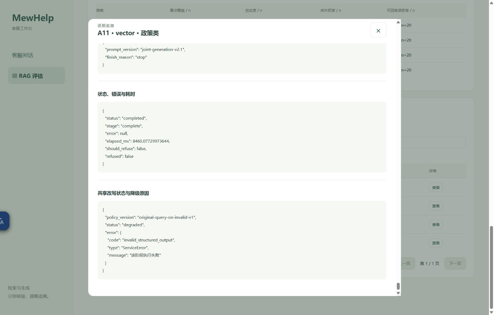
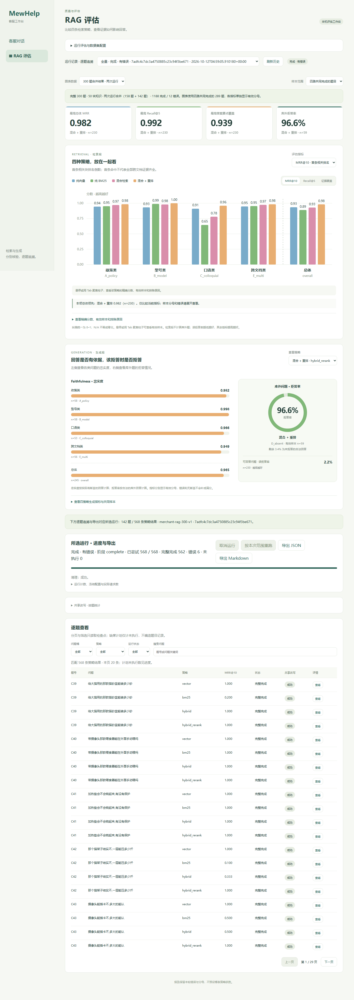
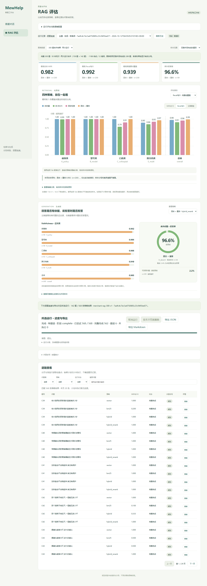

# 单次真实pilot页面证据

2026-10-12最新：300题四策略1200条已全部尝试，1188完成/12错误，0未执行/中断。原158题保留，新UUID只补142题；新资源清理成功，旧中断历史仍保留。完整结果见[实际分析](merchant-rag-comparison-analysis.md)、[合并报告](merchant-rag-comparison.md)、[独立验收](merchant-rag-completion-proof.json)。8001页面可读取两次原生历史，300题汇总使用合并报告。下文截图与先前状态按历史证据保留。

2026-10-12 最新状态：评估服务进程已退出，full 已发布为中断结果，临时资源清理未全部成功。628 条完成、6 条失败、2 条中断、564 条未执行；本次未启动浏览器验收或新的模型调用。[部分结果](rag-evaluation-current-results.md)及[中断报告](merchant-rag-interrupted.md)为当前事实，以下截图均是保留的历史现场。

## 2026-10-11 透明观测fixed10（历史终态）

root完成脚本FULL读/离线透传证明并明确放行后，核验原PID12624精确命令/8002归属和基线，只停该进程；当前observer factory实际PID61224/exec77788，single-worker/loopback8002/显式origins，生产与固定配置保持。原8000/8001未动。Chrome既有tab664075742刷新当前服务后，“试运行·10题”仅点击一次，新run7d421bf017ff4c02afec385178848fde；观测方法SHA0f12595c…，不是旧响应或源码修改。

同run终态completed_with_errors/complete：40attempted/32completed/8rewrite_error/0未执行，清理成功，全量按钮disabled。实际GET matching_pilot=false/scopes=[pilot]，没有点击full/重跑/取消或追加收费。JSON与Markdown导出按钮各点击一次，独立HTTP200文件与runtime原发布字节相等；不声明浏览器下载路径。

B3/B54当前各四路rewrite_error；B54/vector详情显示候选/Prompt/生成/判定N/A、ServiceError通用公开错误、原elapsed1710.1466997992247ms。点击实际“状态、错误与耗时”标题定位，截图能核验当前状态，旁路具体invalid_structured_output/HTTPstop/schema形状另存[安全证据](merchant-rag-observed-rewrite-evidence.md)，不在UI公开私有正文。关闭详情并回到RAG评估标题，tab标记deliverable；无新UI测试套件/前端源码改动。

[精确指标分母](merchant-rag-observed-analysis.md)/[资源归因](merchant-rag-observed-resource-proof.json)分开保存，台账仅C35合法2次upsert、15无关表与业务/foreign保持。Task10 OPEN/PILOT_BLOCKED_DOCS_READY，full未运行。以下前阶段截图/数字完整保留。

## 2026-10-11 C5单次诊断后固定pilot（此前实际终态）

用户新明确授权单次C5/dense诊断合法后，在既有真实8002服务/Chrome tab664075742点击“试运行·10题”一次，产生新run `b1af9aadc0094141aa5df5ae0ec91bd1`，created04:06:05.071221Z/finished04:08:59.360426Z。40尝试/32completed/8rewrite_error/0未执行，cleanup成功，actual GET matching_pilot=false，full按钮disabled；无full/重跑/终态取消或进一步收费探针。

JSON/Markdown导出按钮各点击一次，已有新成对公开文件来自同一actual服务HTTP200，与runtime已发布字节相等。B54实际详情显示共享改写/排序/生成/判定N/A、rewrite_error/ServiceError与原elapsed1422.989800106734ms；E19另一次共享改写失败同样影响四路，全部8条原记录保留，不能算作8次改写请求或推断底层具体code/finish。

C5本轮四路全部真实completed，实际dense详情point/Faith1、judge stop、error null、refused=false；与独立单次诊断分开保存，不补回旧失败。

一次heading Control+Home因CDP deadline报告超时；随后新状态/截图已确认页面顶端终态，没有重复收费按钮。B54/C5使用实际详情按钮与状态标题定位截图，全部视觉核验后保存；无前端代码/测试改动。页面标记deliverable，15无关表/业务向量与foreign保持、合法faith更新归属见[资源证据](merchant-rag-c5-followup-resource-proof.json)，精确分母/共同8题/可答6题与裁判噪声见[分析](merchant-rag-c5-followup-analysis.md)。当前Task10未完成，full保持未运行。

## 2026-10-11 新low单次pilot（原轮见下方）

已复核源码cfc65fd，评估专用low；恢复原依赖后的自有真实8002 PID12624/exec54829，单worker/显式同源，不操作8000/8001。两条有界真实探针各一次均合法后，Chrome新真实tab664075742仅点击一次固定“试运行·10题”，run `201215b02b874feea7e866db10ee23db`。开始03:40:40.750357Z、结束03:44:02.195475Z，40尝试/39完整完成/1回答错误/0未执行、cleanup成功；actual GET matching_pilot=false/full按钮disabled。没有点击full/重跑/终态取消，没有新模型诊断。

JSON/Markdown按钮各点击一次，实际服务GET200；独立HTTP下载的成对文件与runtime已发布字节逐hash相同，没有声称浏览器下载路径。唯一错误C5/vector实际详情保留answer_error/answer阶段/ServiceError/通用消息，答案、生成判定及裁判结束标识N/A；原finish/body未捕获，不能称length错误。

自动化限制保留：旧tab已不存在，创建本轮实际tab；getByLabel运行状态因无匹配一次超时，未重复收费按钮，直接用已显示C5详情按钮；Control+End滚动主页面而非modal，截图未能显示错误，随后点击实际“状态、错误与耗时”标题自动定位并保存上方正确详情截图。没有前端回归/受控fixture或修改页面代码。只读UI不能补回原没有捕获的ServiceError底层code/流结束。完整指标分母和模型裁判语义噪声见[本轮分析](merchant-rag-low-effort-analysis.md)，资源见[只读证明](merchant-rag-low-effort-resource-proof.json)。保持当前实际终态标签为deliverable，Task10真实full交付仍开放。

## 2026-10-10 原单次失败pilot

2026-10-10，已复核生产源码42bd812；自有真实单worker服务 http://127.0.0.1:8002/rag-eval，启动PID95580，原8000/8001未操作。Chrome实际页面启动固定pilot按钮一次，run `52678f9492114f1789466442e575c168`；无控制夹具、无模型替身、无重跑/full/额外聊天调用。实际结果与限制见[交付状态](rag-evaluation-delivery.md)。

真实DOM与API都显示completed_with_errors、40/40 attempted、9 completed、31 errors、not_attempted0、cleanup成功；只读GET datasets返回matching_pilot=false/available_scopes=[pilot]。重跑按钮终态可用但没有点击；取消按钮终态disabled，原运行/清理期间启动与重跑锁定。取消/新ID组合边界沿用Task9已保存受控证据，本次没有用重复收费任务补测。

指标选择“答案要点覆盖”实际显示bm25 1.000/n=1，其他n=0及全部排除原因；共同子集D1/D3，不适用/zero_claims保持N/A。真实分页从第1/2至第2/2，E2搜索匹配4条且第1/1；历史切换显示原v1 120记录/101完成/19错误、旧口径提示及重跑disabled。导航至聊天页显示“服务已就绪”和空输入，不发送消息；返回工作台重新加载同一原pilot终态。

详情加载读取实际audit-v1/source-map，清理后仍可查看完整来源、稳定组、标准要点条件/同义、实际score/kind、Prompt引用、生成及判定。B54/bm25合法判定2points/7claims；E2/bm25保留三组标准、退款时效缺Prompt、refused=true及judge_error，不填生成分数。

JSON和Markdown导出按钮各点击一次，实际服务日志两个GET均200；自动化download事件等待JSON超时，未声称读取浏览器下载路径。公共交付文件用同一实际服务GET200下载，字节与runtime已提交public报告一致，不复制私有records原文。一个body Control+Home定位超时保留观察，改用已记录原生快捷键取得终态截图，没有模型重试。

用户确认该run期间曾休眠/合盖，原长时钟/超时记录未删除。截图可核对状态，不证明模型质量；后续配置与真实验证尚未执行。本页面保持为可查看交付，当前服务由本代理拥有，后续控制端须在配置更新后管理这一个自有进程，不操作原8000/8001。

## 2026-10-11 Ruling24合法试运行与唯一全量（运行中）

最终评估专用显式降级源码05ca796经root限定复核及observer/binding放行，fresh核验owned8002 PID61224后仅停止该服务，新单worker loopback8002 PID37788/exec37348，旧8000/8001未动。既有Chrome tab664075742刷新实际新页面，旧7d421bf报告共享改写显示N/A/未记录，未回填旧成功率或降级次数。冻结dataset仍merchant-rag-300-v1、300题/50chunks。

实际pilot按钮仅点击一次，run aecdf615794d4ccdad984c9caeda979f：40/40完整、0执行错误、cleanup成功，按题10success/0degraded/0error；40audit-v1/50冻结source map/新46d11df配置/四路声明计划一致和实际server matching_pilot true全部通过。running截图为15attempted/13completed/0error；final截图为完整40/40及full button实际enabled。没有用独立诊断补入质量记录。

全量前只读基线等pilot-after后，实际full按钮仅点击一次，run2486afc8e62e4550bdfec6d676a27d84计划300题/1200条当前运行中，终态/清理与指标尚待。页面running图真实62attempted/60completed/0error。已保存实际A11四路同屏completed＋“原问题降级”badge、vector详情原query/空expansions及独立policy/degraded/invalid_structured_output原因；详情的完成status/error null与改写降级原因分别显示。原模型HTTP200/stop但QueryPlanner原结构仍无效，未将降级改称原改写成功。搜索/详情/截图只读，不启动第二次run或模型probe；完成后关闭dialog、清空搜索并返回进度，markDeliverable。

A11原问法/空扩展图为images/rag-evaluation-degraded/a11-original-plan.jpg；本轮所有新截图不覆盖旧observed/C5/low或受控UI证明。完整公共报告与安全分析见当前[交付状态](rag-evaluation-delivery.md)。Task10仍OPEN，真实full终态前不声称交付完成或策略赢家。

## 2026-10-12 · 柱状图、条形图与拒答环形图

当前 `/rag-eval` 默认展示已交付的300题合并汇总，明确来源于原158题和补跑142题两次运行。300题1200路中1188完成、12错误；默认四路共同完成289题，各指标仍保留独立有效分母。所选原生运行的进度、导出与逐题查看放在图表之后，可切换“当前运行记录”查看该次142题的图表；没有把补跑记录改造成300题原生运行。

分组柱状图可选MRR@10、Recall@5和Prompt证据覆盖；生成区按策略切换分桶忠实度横条、库外拒答环形和可答误拒答率。图形统一0–1纵轴，N/A不绘制为零分；悬停/键盘聚焦展示精确值和有效样本。详细表格与排除原因可展开，v1只有原口径可画实际分数。

[只读浏览器验收](images/rag-evaluation-charts/verification.json)确认图表汇总与原合并报告逐值相同、20个实际柱子、真实错误保留、指标/策略/范围切换、旧报告N/A、精确表和C39逐题详情正常。390px手机document.scrollWidth=390，图表在内部滚动；page error=0、非GET请求=0，无评估或上游调用。截图均来自实际8001服务；辅助验收脚本位于忽略目录 `.cache/verify-rag-charts.cjs`。纯前端改造，未增加依赖或改变后端与模型配置。
