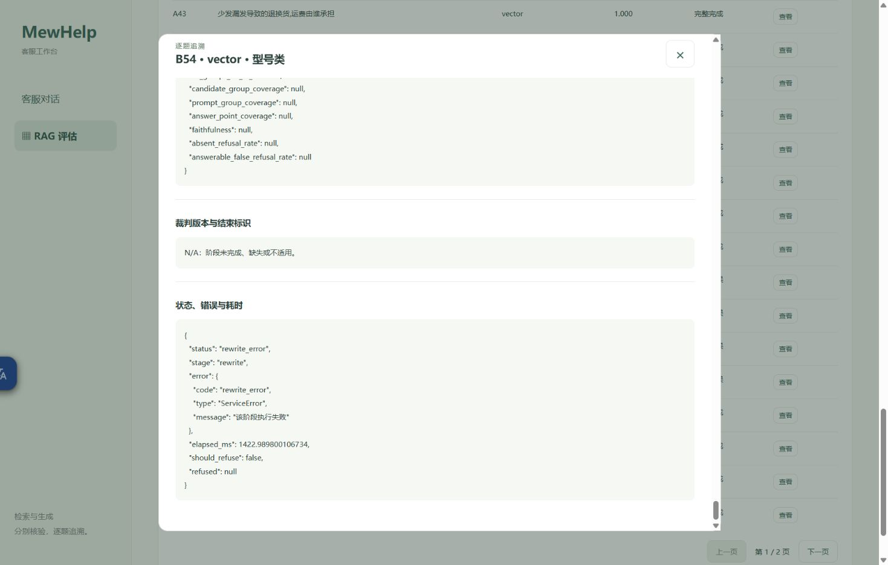
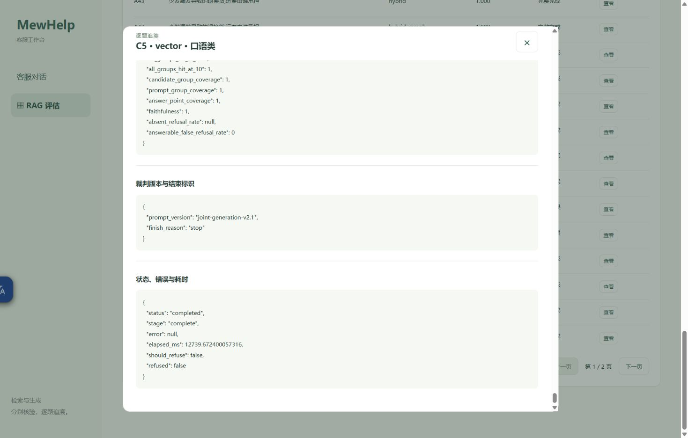
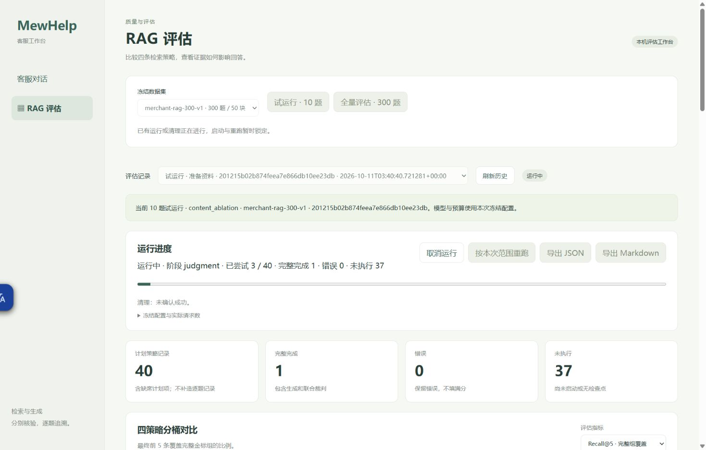
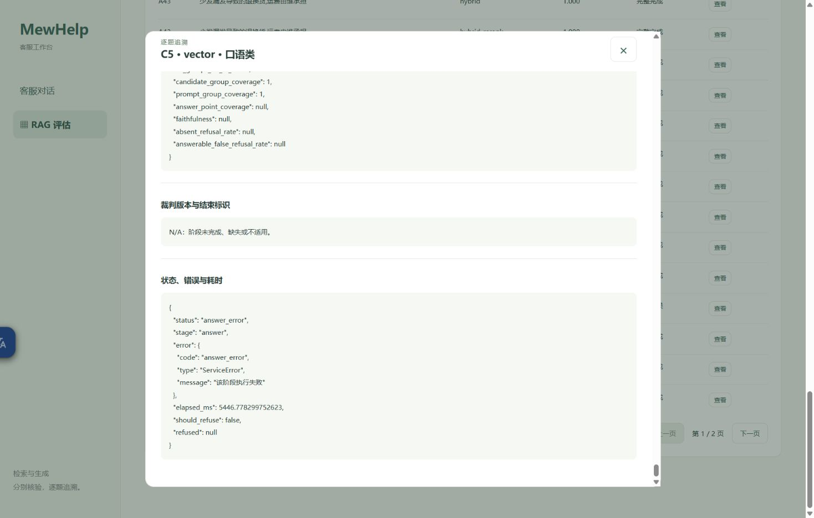
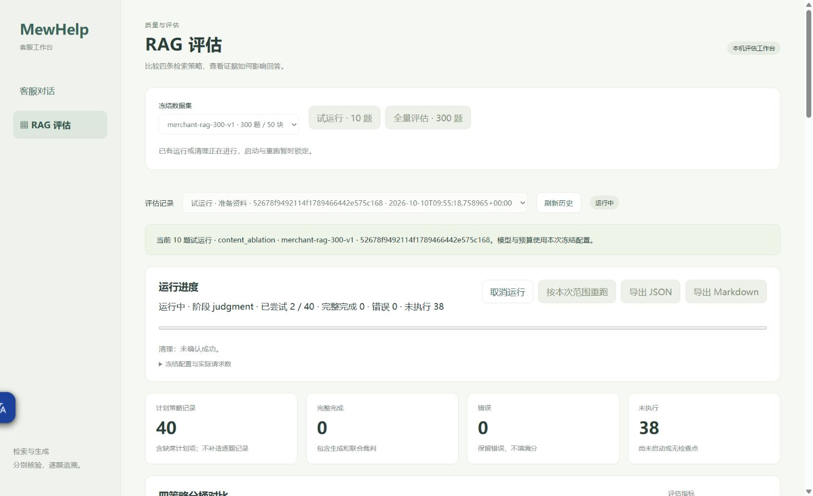
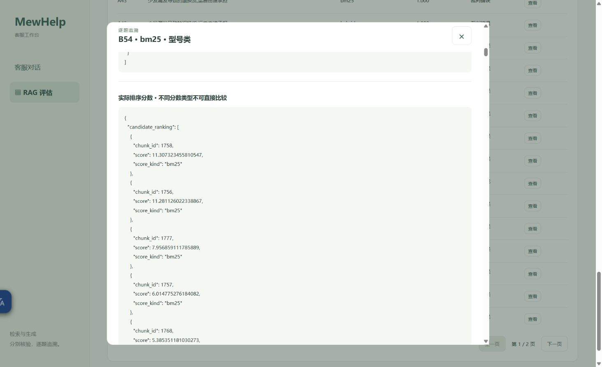
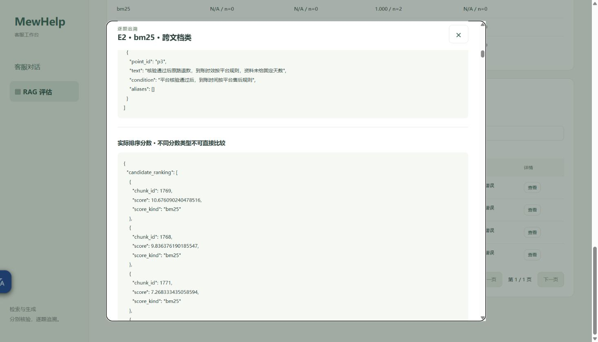

# 单次真实pilot页面证据

## 2026-10-11 C5单次诊断后新固定pilot（当前实际终态）

用户新明确授权单次C5/dense诊断合法后，在既有真实8002服务/Chrome tab664075742点击“试运行·10题”一次，产生新run `b1af9aadc0094141aa5df5ae0ec91bd1`，created04:06:05.071221Z/finished04:08:59.360426Z。40尝试/32completed/8rewrite_error/0未执行，cleanup成功，actual GET matching_pilot=false，full按钮disabled；无full/重跑/终态取消或进一步收费探针。

JSON/Markdown导出按钮各点击一次，已有新成对公开文件来自同一actual服务HTTP200，与runtime已发布字节相等。B54实际详情显示共享改写/排序/生成/判定N/A、rewrite_error/ServiceError与原elapsed1422.989800106734ms；E19另一次共享改写失败同样影响四路，全部8条原记录保留，不能算作8次改写请求或推断底层具体code/finish。

C5本轮四路全部真实completed，实际dense详情point/Faith1、judge stop、error null、refused=false；与独立单次诊断分开保存，不补回旧失败。

一次heading Control+Home因CDP deadline报告超时；随后新状态/截图已确认页面顶端终态，没有重复收费按钮。B54/C5使用实际详情按钮与状态标题定位截图，全部视觉核验后保存；无前端代码/测试改动。页面标记deliverable，15无关表/业务向量与foreign保持、合法faith更新归属见[资源证据](merchant-rag-c5-followup-resource-proof.json)，精确分母/共同8题/可答6题与裁判噪声见[分析](merchant-rag-c5-followup-analysis.md)。当前Task10未完成，full保持未运行。

## 2026-10-11 新low单次pilot（原轮见下方）

已复核源码cfc65fd，评估专用low；恢复原依赖后的自有真实8002 PID12624/exec54829，单worker/显式同源，不操作8000/8001。两条有界真实探针各一次均合法后，Chrome新真实tab664075742仅点击一次固定“试运行·10题”，run `201215b02b874feea7e866db10ee23db`。开始03:40:40.750357Z、结束03:44:02.195475Z，40尝试/39完整完成/1回答错误/0未执行、cleanup成功；actual GET matching_pilot=false/full按钮disabled。没有点击full/重跑/终态取消，没有新模型诊断。

JSON/Markdown按钮各点击一次，实际服务GET200；独立HTTP下载的成对文件与runtime已发布字节逐hash相同，没有声称浏览器下载路径。唯一错误C5/vector实际详情保留answer_error/answer阶段/ServiceError/通用消息，答案、生成判定及裁判结束标识N/A；原finish/body未捕获，不能称length错误。

自动化限制保留：旧tab已不存在，创建本轮实际tab；getByLabel运行状态因无匹配一次超时，未重复收费按钮，直接用已显示C5详情按钮；Control+End滚动主页面而非modal，截图未能显示错误，随后点击实际“状态、错误与耗时”标题自动定位并保存上方正确详情截图。没有前端回归/受控fixture或修改页面代码。只读UI不能补回原没有捕获的ServiceError底层code/流结束。完整指标分母和模型裁判语义噪声见[本轮分析](merchant-rag-low-effort-analysis.md)，资源见[只读证明](merchant-rag-low-effort-resource-proof.json)。保持当前实际终态标签为deliverable，Task10真实full交付仍开放。

## 2026-10-10 原单次失败pilot

2026-10-10，已复核生产源码42bd812；自有真实单worker服务 http://127.0.0.1:8002/rag-eval，启动PID95580，原8000/8001未操作。Chrome实际页面启动固定pilot按钮一次，run `52678f9492114f1789466442e575c168`；无控制夹具、无模型替身、无重跑/full/额外聊天调用。实际结果与限制见[交付状态](rag-evaluation-delivery.md)。

真实DOM与API都显示completed_with_errors、40/40 attempted、9 completed、31 errors、not_attempted0、cleanup成功；只读GET datasets返回matching_pilot=false/available_scopes=[pilot]。重跑按钮终态可用但没有点击；取消按钮终态disabled，原运行/清理期间启动与重跑锁定。取消/新ID组合边界沿用Task9已保存受控证据，本次没有用重复收费任务补测。

指标选择“答案要点覆盖”实际显示bm25 1.000/n=1，其他n=0及全部排除原因；共同子集D1/D3，不适用/zero_claims保持N/A。真实分页从第1/2至第2/2，E2搜索匹配4条且第1/1；历史切换显示原v1 120记录/101完成/19错误、旧口径提示及重跑disabled。导航至聊天页显示“服务已就绪”和空输入，不发送消息；返回工作台重新加载同一原pilot终态。

详情加载读取实际audit-v1/source-map，清理后仍可查看完整来源、稳定组、标准要点条件/同义、实际score/kind、Prompt引用、生成及判定。B54/bm25合法判定2points/7claims；E2/bm25保留三组标准、退款时效缺Prompt、refused=true及judge_error，不填生成分数。

JSON和Markdown导出按钮各点击一次，实际服务日志两个GET均200；自动化download事件等待JSON超时，未声称读取浏览器下载路径。公共交付文件用同一实际服务GET200下载，字节与runtime已提交public报告一致，不复制私有records原文。一个body Control+Home定位超时保留观察，改用已记录原生快捷键取得终态截图，没有模型重试。

用户确认该run期间曾休眠/合盖，原长时钟/超时记录未删除。截图可核对状态，不证明模型质量；后续配置与真实验证尚未执行。本页面保持为可查看交付，当前服务由本代理拥有，后续控制端须在配置更新后管理这一个自有进程，不操作原8000/8001。
