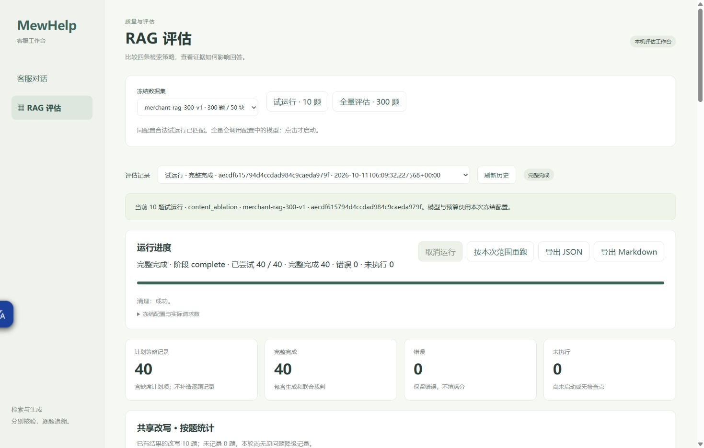
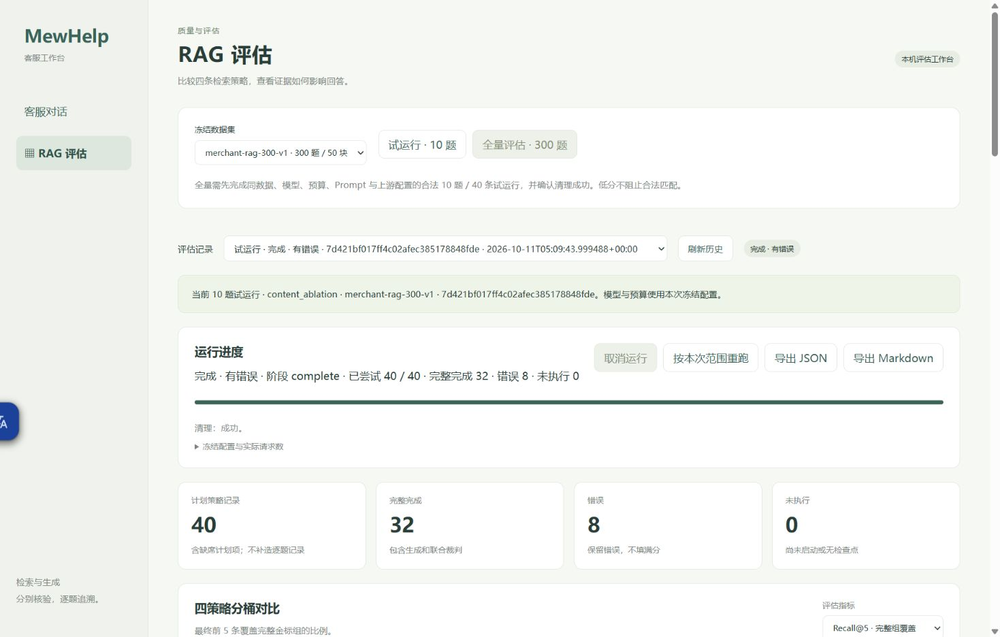
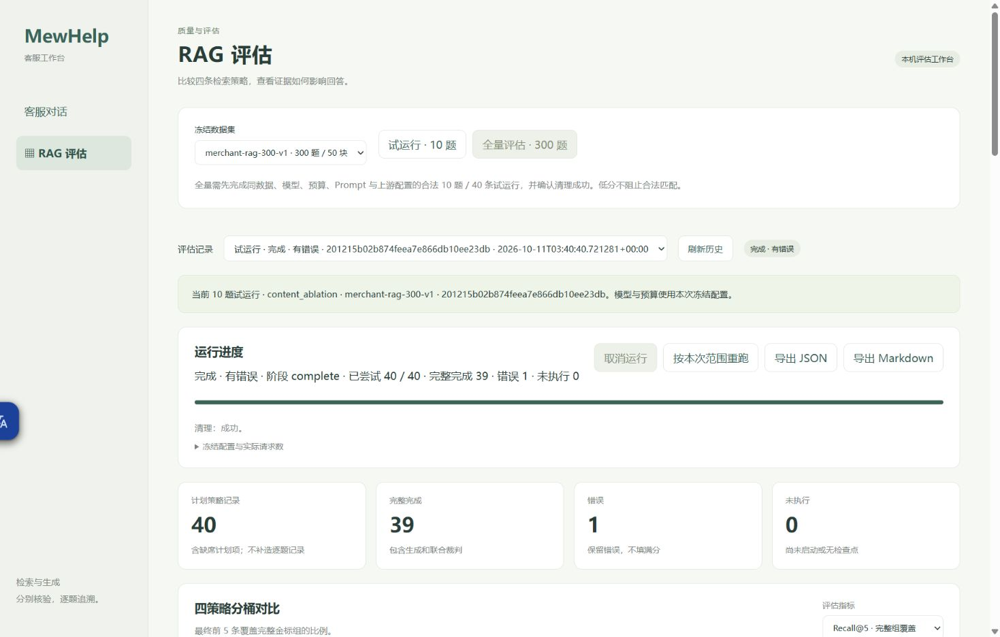
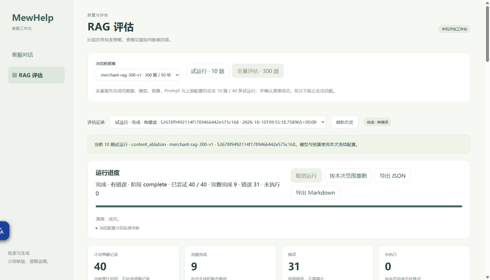

# 冻结 300 题 RAG 评估交付状态

2026-10-12 当前：**300题四策略共1200条全部尝试，1188完成/12错误，0未执行/中断。新UUID只补142题568条，实际562完成/6错误，耗时682.10秒，生产清理成功；原158题及6条明确错误保持。** [实际分析](merchant-rag-comparison-analysis.md)、[合并Markdown](merchant-rag-comparison.md)、[合并JSON](merchant-rag-comparison.json)、[独立验收](merchant-rag-completion-proof.json)已保存。

公平共同题集为289题（可答230、库外59）：hybrid_rerank MRR@10=0.9819、Recall@5=0.9920、答案要点覆盖=0.9395，均n230，四路最高；库外拒答没有达到100%。生成Faith有零断言排除，真实n和所有错误另列，不能用成功样本代替全部1200条。300题改写285成功/15显式原问题降级/0错误。

原run `2486afc8e62e4550bdfec6d676a27d84` 与新run `7adfc4c7dc3a4750885c23c94f3be671` 按整题四路合并，各用原生source-map，不改物理ID、答案或分数。配置46d11df逐值相同，实际操作并发原2/补8单列。原中断报告字节不变，新[原生JSON](merchant-rag-completion-remainder.json)/[Markdown](merchant-rag-completion-remainder.md)与生产文件字节一致。1218份保护文件、全部1200条原值、两份50来源map、生产summary与真实分母经控制端独立离线核对，新增模型调用0。

本次补跑新UUID的50条知识与集合已清理。业务全部8表、测试库除faith_cases之外7表、业务84完整向量、既有集合/统计与校准值保持；质量台账41→93，54条新增/变更均按冻结ledger_eval_id关联本次实际unsupported记录，字段全文未另做独立逐值比较。原中断run历史cleanup失败及其资源仍保留，不能冒称其已清理。

13项辅助专项通过，一项真实24行报告渲染专项通过；两次限定审核均通过，未重跑工程全套或收费试运行。原formatter误读Recall@50已通过独立60行adapter改为真实Recall@5，冻结helper未改，评估未重跑。记录见dev-notes/ch04.md。8001前端保持现有只读服务，历史可查看两份原生运行；300题汇总使用上述合并报告。Task10的全量尝试与报告交付完成，保留12条失败待后续明确范围处理，不自动重试或收费。

## 2026-10-12 此前：中断恢复历史
2026-10-12 当前：**唯一 full `2486afc8e62e4550bdfec6d676a27d84` 的进程已退出，最后执行检查点为北京时间 2026-10-11 15:28:59。已通过生产恢复入口发布中断报告：628 条完成、6 条失败、2 条中断、564 条未执行；`outcome=interrupted`，因临时资源清理遇到数据库和 Milvus 连接错误，`state=failed`、`cleanup.ok=false`。本次没有新增模型请求，原已完成及已失败记录保持。** [部分对比](rag-evaluation-current-results.md)、[完整 JSON](merchant-rag-interrupted.json)、[完整 Markdown](merchant-rag-interrupted.md)已保存。Task10仍开放，不能声称300题完成或总体最佳策略。以下保留此前各阶段的历史证据。

## 2026-10-11 历史：显式降级试运行通过，全量启动

新policy为`original-query-on-invalid-v1`，只在评估共享改写明确invalid_structured_output时记录degraded并使用原query/空expansions，四路共享同一计划；原QueryPlanner严格校验保持。新指纹`46d11df092ca2b803030fb7e227d971ef7530552bb5d18b4939bfc0c7f186ee7`，与旧191d53仅policy及自然指纹变化，GLM/low、512回答/其他2048、所有期限/retry0、Prompt及冻结资料保持。透明方法`.cache/task10_degraded_service.py` SHA`2030d7686f97bb7bc902dfc65c8e88c7ff23a24386de1267339d5845b86391dd`；root完整读取方法/fake身份验证、最终fix1复核及binding后明确执行放行。原planner合法性与保存的runner声明分别留证，不将degraded计作改写成功。

fresh核验旧PID61224精确observer命令及8002监听后仅停止该owned进程，新factory在同loopback8002运行，单worker、显式origin，PID37788/exec37348；8000/8001未动。只读前基线SHA`64e5988b9a65c5000c2c085ffdf6443e67c2fca046c9a041bf79cf8effd1be95`逐字节等observed-after。实际Chrome固定10按钮仅点击一次；[新pilot原JSON](merchant-rag-degraded-pilot.json)/[Markdown](merchant-rag-degraded-pilot.md)与runtime字节相等，40audit-v1、50来源map`af6590ab401319d942bddff0b30213a4cd888b8cf115ebd5cdec3adb87687e55`与冻结重建一致，完整配置=current，实际GET门禁true。按题10success/0degraded是本pilot观察结果，不能冒称已出现真实降级样例。

新pilot计数rewrite10/self40/answer31/judge40/embedding33/rerank10/Milvus74，cleanup={ok:true,errors:[],unverified:[]}。[分析](merchant-rag-degraded-analysis.md)/[安全观测](merchant-rag-degraded-rewrite-evidence.md)/[只读资源归因](merchant-rag-degraded-resource-proof.json)已独立保存：15无关表、业务84完整向量/foreign资源/原集合统计/校准保持；唯一合法faith变化C35 ID25、dense实际unsupported一次使seen4→5，不声称全部16表不变。

full前新只读基线SHA`c402991c087577d6e69b1b0096da827eb67f855a1b868b37343bde8ae3325e5d`等pilot-after；真实full按钮仅点击一次，独占marker另存。当前仅同次全量继续，无探针、第二pilot、重试、调参或源修改；全量公共终态pair尚未生成，不使用1200计划分母冒称1200完成。实际门禁截图如下。



## 2026-10-11 原参数透明观测试跑（历史终态）

用户明确“继续”，root依Ruling23完整读取ignored observer及最小fake对象身份验证后放行。生产源码仍`cfc65fdb99e44de68c2727e05743a384bba6e89e`，当前启动checkout为root文档`a4573b5`；唯一观测方法`.cache/task10_observed_service.py`，SHA `0f12595c000e8c84bcfa7f0182b2b2350fc5e04dd491504b1122400e8474cd8c`单列声明。透传原plan/structured ainvoke请求、返回对象和异常，只在改写旁路私存；原严格JSON/finish/safe-plan/期限、计数、归属、OS锁及cleanup保留，观测IO在原期限内。输入无gold；GLM/low/512回答/其他2048/8000与16000输入/所有期限/retry0及191d53…完整配置与前轮相等，冻结300/five60/50chunks不变。准备model/client/owner/manager构造和upstream均0，fake证明不冒充真实结果。

已核验原PID12624的精确命令行及loopback8002归属，仅停该进程，在同8002启动actual factory、单worker及显式origins；新PID61224/exec77788，旧8000/8001未动。前基线与C5-afterpilot逐字节SHA `9e995a18933deefa8d4e4e12e50bf6300ebd866b97df964acb11516013ac254f`一致。Chrome同tab664075742“试运行·10题”仅点击一次，新run `7d421bf017ff4c02afec385178848fde`，created05:09:43.999488Z、finished05:12:34.318289Z；completed_with_errors/complete，40attempted/32completed/8rewrite_error，其他errors/running/not_attempted/cancelled均0。实际计数rewrite10/self_check32/answer23/judge32/embedding27/rerank8/Milvus67；cleanup={ok:true,errors:[],unverified:[]}。

本轮独立[实际JSON](merchant-rag-observed-pilot.json)/[Markdown](merchant-rag-observed-pilot.md)来自HTTP200，416610/602479字节，SHA `a5d035e203c1367ffc7318f4ac9cb195c3caa2e04817380bc0602dd500bf48e8` / `eb69ecf393e1ead68254a96f2d4ea98dca70bbd4ab2479100f7dd8dc25c93a19`，与runtime发布字节相等。40条audit-v1、50实际来源1881–1930、map `3897a4e4fcbc6dd389e75bb5292976d61985ae1f9f1b05348850dd63afac33ee`与冻结来源重建相等，完整当前配置与生产文件SHA保持。actual GET matching_pilot=false/scopes=[pilot]，full按钮disabled，未运行full或生成comparison文件。

[独立安全观测JSON](merchant-rag-observed-rewrite-evidence.json)/[Markdown](merchant-rag-observed-rewrite-evidence.md)不补入质量记录。十次改写实际出站10、观测错误0，HTTP/LC均stop；B3原JSON为两项list（第一项answer包裹、第二项standard/expansions），B54根仅answer包裹standard/expansions。两题parsed=NoneType/parsing_error=OutputParserException，生产ServiceError.code=invalid_structured_output；各一次共享失败影响四路。其余八题严格校验与safe-plan通过，E19本轮合法，不能用上一轮E19错误代替本轮。root独立离线核对十份HTTP正文与AIMessage逐字相等、输入hash、失败raw JSON严格拒绝及合法最终plan一致，核验上游0。完整正文/异常cause仅私有，不反推旧未捕获失败根因，不称增加预算可解决或bugfixed。

[精确分析](merchant-rag-observed-analysis.md)/[JSON](merchant-rag-observed-analysis.json)保存24行/264指标value/valid_n/excluded及全部合法可答排名。共同四路合法8题A21,A43,C35,C5,D1,D3,E19,E2；共同可答6题A21,A43,C35,C5,E19,E2。各策略8完成/2错误，Recall5=1/.8888888888888888/.9444444444444445/1，Recall10与Prompt=1/.9444444444444445/1/1，MRR=1/.8888888888888888/.9166666666666666/1，均n6；要点1/.9444444444444445/1/.75，均n6。总体Faith=1/n7、1/n6、.9523809523809524/n7、.9642857142857143/n7；库外拒答1/n2各路，可答误拒答0/0/0/.16666666666666666，n6各。共同可答Faith=1/n6、1/n6、.9444444444444445/n6、.95/n5。rerank本轮E19误拒答与Faith的zero_claims不重标；候选50/语料50饱和局限保持，不设总体赢家或300题泛化。D1四路相同固定拒答claims分别0/0/0/1，D3为2/0/2/2，unsupported均0；保留模型裁判断言拆分噪声，不当人工真值。

[只读资源归因](merchant-rag-observed-resource-proof.json)：15无关表摘要、业务84知识/完整向量hash、foreign7知识和旧foreign4faith、三个既有集合名/stats及校准值保持；只有C35 ID25合法faith upsert2次，seen_count2→4，最终hybrid_rerank字段/引用/unsupported理由/模型匹配实际记录，faith总9→9，无新增行。run UUID资源cleanup成功；其他集合只核对名/统计，不冒称完整vectorhash。



实际进行中/错误详情与导出操作见[UI新增记录](rag-evaluation-actual-ui.md)。收费已停止，无第二pilot、独立probe、调参/源修改、工程suite/review或merge/push。状态PILOT_BLOCKED_DOCS_READY，Task10 OPEN，真实300交付未完成；后续变更仍需新明确范围。

## 2026-10-11 B54独立单次诊断（收费已停止）

用户新批准B54改写一次，root完整读取脚本并明确放行后执行probe `59e4d535ec0c4471bbe2538e2c18a39d`。真实耗时2.889186199987307秒，HTTP200/finish=stop，原AIMessage108字符；原JSON三条expansions通过生产严格校验，现有safe-plan保护返回原问句/expansions0。模型GLM-5.3-Flash、low、2048输出、847/8000输入、SDK/改写60秒、retry0及完整191d53…配置保持。实际HTTP1/rewrite1，self_check、answer、judge、embedding、rerank、Milvus六阶段均0，cleanup={ok:true,errors:[],unverified:[]}。无数据库/Milvus、浏览器或服务重启操作，8000/8001未动。

独立[安全JSON](merchant-rag-b54-diagnostic.json)/[Markdown](merchant-rag-b54-diagnostic.md)保存捕获边界及完整安全计数；原输入/正文仅私有。执行前离线构造器/proof消息摘要一致、无gold；原请求字节未保存，不声明原字节相等。root独立离线复核生产strict validator/safe-plan、计数、cleanup和原六个公开报告SHA通过，额外请求0。旧B54失败具体finish/code/raw缺失，本次成功不能确定旧根因或称bug修复，旧报告不覆盖、不补行。诊断不进入pilot资格或质量分母。当前最新pilot仍32/40、full未运行、Task10 OPEN；该范围仅一次诊断，成功也不授权新pilot/full或其他探针，收费已经停止。

## 2026-10-11 C5单次诊断与条件继续的实际终态

用户明确批准“允许单次诊断并有条件继续”后，使用root完整审阅的ignored单次保护脚本，仅执行C5/dense回答一次。诊断 `5e6b712636684cd1bd3c5ec469192050` 在04:04:41.002853Z至04:04:45.648592Z，4.645735秒、158字符、stop及严格引用/完整性验证通过；真实计数answer1，其余所有收费/资源阶段0，cleanup成功。原10引用逐值相等，输入估算5726/8000，无gold，prompt/source-map与当时捕获一致；GLM-5.3-Flash/low/512/retry0/SDK60秒/chat240秒与配置指纹191d53…保持。完整输入和流事件仅私有，安全[JSON](merchant-rag-c5-diagnostic.json)/[Markdown](merchant-rag-c5-diagnostic.md)分开保存。成功不能解释旧失败的未捕获finish/code，也不补入原pilot或授予full资格。

在真实资源新前基线与上一轮afterpilot完整相等后，既有8002单worker服务/Chrome tab664075742仅点击一次固定试跑，run `b1af9aadc0094141aa5df5ae0ec91bd1`，created04:06:05.071221Z，finished04:08:59.360426Z，completed_with_errors/complete。40attempted/32completed/8rewrite_error；其他错误、running/not_attempted/cancelled均0。实际计数rewrite10/self_check32/answer22/judge32/embedding27/rerank8/Milvus67；cleanup={ok:true,errors:[],unverified:[]}。B54/E19的改写elapsed分别1422.989800106734/1839.666800107807ms，生产共享失败各投影4路；原具体ServiceError.code、finish/raw没有保存，不能按通用rewrite_error确定原因或当作8次改写调用。失败后没有重跑、调参或追加探针。

新[真实JSON](merchant-rag-c5-followup-pilot.json)/[Markdown](merchant-rag-c5-followup-pilot.md)由HTTP200导出，420915/611745字节，SHA分别 `37020a3058913b3e7454023aab58603c27393654f1e6ee8a76337c941dc1b47a` / `84da91d9adbc19250a5c24f0119d318d9163649dd6cfdb9a7397bb7bf5ea0167`，与runtime发布字节相等。全部40audit-v1、实际50来源1831–1880、map `d2dd350d860b8141e52306cbbcafb22f97d091194eb1cdc839a528c2990715eb`经冻结资料重建相等，当前/前一low完整配置相等。GET datasets仍matching_pilot=false/scopes=[pilot]；full按钮disabled，full没有run或1200条虚构记录。

[精确派生分析](merchant-rag-c5-followup-analysis.md)/[JSON](merchant-rag-c5-followup-analysis.json)保留全部24行总体/五桶的每项value/valid_n/excluded和实际排名；错误不从40总体删除。共同四路合法8题为A21,A43,B3,C35,C5,D1,D3,E2，其中明确可答6题为A21,A43,B3,C35,C5,E2。总体dense/bm25/hybrid/rerank各completed8/error2，Recall5=1/.8888888888888888/.9444444444444445/1（n6各），Recall10及Prompt=1/.9444444444444445/1/1，MRR=1/.8888888888888888/.9166666666666666/1。要点1/.6666666666666666/1/.8611111111111112（n6各），Faith .8571428571428571/n7、1/n5、.7/n8、.9821428571428571/n7；库外拒答1/n2各路、可答误拒答0/.3333333333333333/0/0（n6各）。共同可答6题Faith=1/n6、1/n4、.9333333333333332/n6、.9791666666666666/n6；bm25的两条误拒答仍在要点/误拒答分母，仅zero_claims不进Faith。候选50/语料50的饱和局限保持，不宣称赢家或300题泛化。

C5本轮四路均真实completed/useful=true/refused=false、point2/2、Faith1；dense5claims、其他3claims，裁判stop。D1/D3四路协议refused=true且固定回答逐字相同，但D1各路裁判claims/unsupported为2/2、1/0、1/1、2/0，D3为0/0、0/0、2/2、0/0。保留模型裁判噪声与原verdicts，不重标人工真值。其他unsupported为A21/rerank1/8和C35/hybrid2/5。

[本轮只读资源归因](merchant-rag-c5-followup-resource-proof.json)：3307全部8表和3308除faith之外7表SHA不变，业务84知识/向量、foreign7知识及旧foreign4faith保持，三个原Milvus集合名/stats、业务完整向量hash/校准值保持；本run UUID资料清理成功。faith8→9，新增ID28/A21 seen1，合法更新ID25/C35 seen1→2、26/D1 seen1→3、27/D3 seen1→2，共5个实际unsupported upsert。最终query/answer/strategy/citations/reason/model逐字段匹配本轮实际记录、次数等于既有1加本轮次数；不能把合法质量台账更新称为全部16表不变。其他集合只核对名/统计，不冒称完整vectorhash。


更多真实详情与控件证据见[UI追加记录](rag-evaluation-actual-ui.md)。源码仍为已复核cfc65fd；诊断开始checkout51c6306、root后续41cfe4d只记录文档，未改源码/工程套件。状态PILOT_BLOCKED_DOCS_READY，真实300交付仍开放；后续付费或修复需要新的明确范围。

## 2026-10-11 前一低思考有界验证与依赖恢复记录

评估专用配置生产提交 `cfc65fdb99e44de68c2727e05743a384bba6e89e`，本阶段checkout为仅追加root文档的 `51edf90120010ceaa7ca0a5fa35c6954d3a25b1a`；独立规格PASS/质量Approved，Critical/Important均0。已读取原始RED17failed/8passed、GREEN25passed、最终受影响262passed/7skip以及默认完整1438passed/116skip（260.94秒），没有重复工程套件。只增加评估专用 `reasoning_effort=low` 与指纹出处，在线模型参数不变。新指纹 `191d53c027323fa8005327336e6ec0e737f7d196eebd6ad05f2dea7258f60913`；剔除这一新增字段和fingerprint后，与原实际pilot配置逐值相等，所有模型、512/2048输出、输入预算、期限、Prompt、端点和重试0不变。

两条请求先离线重建：A21/bm25使用原224字符回答、7条实际引用、p1/p2两项完整rubric；B3/bm25使用原source-map草稿、实际final ranking/score/kind及candidate_count，通过生产grounded-answer/build_evidence、空历史和eval-faq工具消息重建，10条Citation与原值完全相等，生成输入无gold/rubric。原生成消息没有独立保存，这证明同生产者/证据重建，不宣称原消息字节hash相等。原公开JSON/Markdown摘要均核对保持。

真实探针ID `abcfea557efd4b62a5741fd65bfafa12`：裁判6.8016秒、stop、严格JSON与完整唯一p1/p2通过，2项覆盖、5个断言均有证据支持；回答4.3092秒、stop、449字符及严格引用通过。实际HTTP请求逐条捕获顶层low及裁判2048/回答512，计数judge1/answer1，其余0，重试0。裁判实际usage为prompt1454/completion430（其中reasoning111）/total1884；回答未请求额外usage帧，未推算其token消费。客户端cleanup成功，没有准备/写入数据库或Milvus，没有进行重标或将两条探针补入原40条结果。公开[JSON](merchant-rag-low-effort-probes.json)/[Markdown](merchant-rag-low-effort-probes.md)只含安全验证元数据，完整输入与模型正文仍私有。

继续新固定pilot前，只读资源基线返回OperationalError；明确探测3307/3308/19530均ConnectionRefusedError（10061）。原拥有PID95580已不存在，8002也拒绝连接。新固定解释器single-worker/显式origins/评估low启动attempt（exec80376）因Milvus不可连接而启动失败并退出；没有运行pilot/full，未取得新资源对比，不能复用旧资源摘要宣称本次环境已验证。没有操作8000/8001、启动依赖、重建数据或追加付费调用。Root随后明确授权只恢复既有Docker Desktop/精确原容器与卷；已核对原身份/端口/项目/6挂载卷，启动5个原依赖且全部healthy，foreign/init容器未操作。启动途中一条只读快照MilvusException保留，健康后的新只读基线与原afterpilot完全一致（全部16表SHA、业务84向量、三个原集合名/统计、校准值）。新实际8002 PID12624/exec54829已启动，原失败日志不覆盖；新pilot201215b02b874feea7e866db10ee23db在2026-10-11T03:40:40.721281Z从真实浏览器仅启动一次，两条合法探针没有重复。只有新低思考pilot40条全部合法、audit/map/配置匹配及cleanup通过后，服务端matching_pilot才可授权full一次。

本文保留生产提交 `77d7d02ef1fb500e3ae00f069c368fd204135b3a` 的原始完整回归，再追加已复核源码 `42bd8126a7377b021af8e9d0365e33cfb922808e` 的N1/N2最小修复与真实阶段。仅文档阶段最初checkout为 `2bdb84c43c39b8934a4bfb36c9aa92ecf91d1806`；本次真实阶段启动checkout为root文档提交 `bfd6d3a5917fcb9f585e1920f13a5c956767f492`，生产源码与已复核42bd812相同。原阶段无服务/模型调用的记录是历史事实；本阶段已按明确授权启动当前真实服务及固定pilot，未重跑工程套件。

## 实际运行与待交付内容（四轮报告分开）

| 阶段 | 冻结计划规模 | 本次实际状态 | 实际运行 ID / 新质量结果 |
| --- | --- | --- | --- |
| 原Pilot（未捕获effort） | 固定10题 × 4策略 = 40条 | 单次真实运行completed_with_errors；9完成/31错误/0未执行，清理成功 | `52678f9492114f1789466442e575c168`；[JSON](merchant-rag-pilot.json)、[Markdown](merchant-rag-pilot.md) |
| Low Pilot | 同固定10题 × 4策略 = 40条 | 单次真实运行completed_with_errors；39完成/1回答错误/0未执行，清理成功 | `201215b02b874feea7e866db10ee23db`；[JSON](merchant-rag-low-effort-pilot.json)、[Markdown](merchant-rag-low-effort-pilot.md) |
| C5诊断后新Pilot | 同固定10题 × 4策略 = 40条 | 新范围仅一次completed_with_errors；32完成/8改写错误/0未执行，清理成功 | `b1af9aadc0094141aa5df5ae0ec91bd1`；[JSON](merchant-rag-c5-followup-pilot.json)、[Markdown](merchant-rag-c5-followup-pilot.md) |
| 透明观测新Pilot | 同固定10题 × 4策略 = 40条 | 新范围仅一次completed_with_errors；32完成/8改写错误，清理成功 | `7d421bf017ff4c02afec385178848fde`；[JSON](merchant-rag-observed-pilot.json)、[Markdown](merchant-rag-observed-pilot.md) |
| Full | 300题 × 4策略 = 1200条 | 未运行；同配置40条合法门槛未满足 | 无run、无比较报告或虚构分母 |

原轮40条是实际终态记录数，完整完成仅9条；新低思考轮39/40的全部指标与共同子集另见[派生分析](merchant-rag-low-effort-analysis.md)，不覆盖原轮。公共成对报告直接来自实际服务HTTP导出，包含schema-v2/audit-v1、单份50来源map、冻结配置、实际请求数、24行总体/分桶统计及共同子集。full没有manifest，不能将尚未运行的计划写成1200条 `not_attempted` 或虚构分母；没有生成 `merchant-rag-comparison.json/.md`。Task9夹具与受控规模/检索证明不计真实收费运行。

原始裁判及归属快照仍只在忽略的runtime目录，公共报告没有raw_response或连接凭据。JSON SHA-256为 `b2865bbd127305bf2436b28c69fc1bdd35ac14a39f065f42bb5a9b9028725501`，Markdown为 `48e5eeee19f0a20c0470fa90da92c28b3e12b96e66ef3ef84d20742bf72bc352`。错误如实交付，未重跑原pilot或启动full。

## 2026-10-11 前一low pilot终态与完整交付

实际开始 `2026-10-11T03:40:40.750357+00:00`，结束 `2026-10-11T03:44:02.195475+00:00`，201.445118秒；state/outcome=completed_with_errors、stage=complete、40尝试/39completed/1answer_error、running/not_attempted/cancelled均0。改写10、自评40、回答30、裁判39、嵌入33、重排10、Milvus74（含prepare/cleanup）；配置为上方专属low指纹，同模型预算期限与retry0。全部40条audit-v1与实际50来源map `bd42c33a64d0de65feee52807ae8153f7f6935c4bbd2b32ee77ba496aa6d3973`，由冻结资料与实际IDs重建逐值相等；cleanup={ok:true,errors:[],unverified:[]}。actual GET datasets仍matching_pilot=false/available_scopes=[pilot]，full一次也未启动。

公共对报告直接HTTP200下载，JSON496307字节/SHA `d0c97061a1b62c85378a44e3f8ed95b693ed3dcd4e5242ef846a23facfd9e8ee`，Markdown712461字节/SHA `c0bf7930537e0c78a469c8f9d3176f00cbce96d02df304b80e764b31e17c9b9e`，与runtime发布字节完全相同。浏览器导出按钮各点击一次；无浏览器下载path声明，以实际HTTP文件为准。原9/40报告原SHA不变。

[实际指标与解释](merchant-rag-low-effort-analysis.md) / [精确派生JSON](merchant-rag-low-effort-analysis.json)列出四策略/五桶的所有valid_n与excluded、总体Recall@5/10、MRR、Prompt、要点/Faith/拒答及四路共同9题，另明确其中可答7题的生产聚合结果。总体dense/bm25/hybrid/rerank的Recall@5分别1/.9166667/.9583333/1（各n8）、@10为1/.9583333/1/1；要点覆盖1/n7、.75/n8、1/n8、.8333333/n8；Faith .90625/n8、.8761905/n7、1/n8、.952381/n7；库外拒答.5/1/1/1（各n2）、可答误拒答0/n7、.25/n8、0/n8、.125/n8。共同9题要点/Faith：hybrid1/n7、1/n7；rerank .8095238/n7、.9444444/n6，不能据检索单项领先认定重排赢家。C5错误不从整体删除，仅整题不能进入四路共同集合；可答共同7题包含真实误拒答，预先按should_refuse划分，不按分数挑样本。

C5/dense answer阶段ServiceError，原记录仅generic answer_error/固定消息，elapsed5446.778299752623ms；self-check useful=true、运费金标在10条实际引用中。答案/拒答标识/判定/裁判快照均null，流finish/body和底层ServiceError.code未捕获，不推断length或引用/网络原因。39个合法裁判全部stop；无新judge/timeout错误。没有新paid诊断/重试/调参/全量。

D1/dense的自评理由明确无活体证据但useful=true，正文语气表达不确定仍协议refused=false，不能重标为固定拒答。D3四路完全相同固定拒答被bm25裁判提3断言（2不支持），其他路claims为空；这说明模型裁判有语义噪声，原verdicts与分母不改，不能当成人工真值。A43/rerank少发漏发归类、C35/bm25人工工单建议、D1/dense与D3/bm25断言构成四个合法质量台账快照。

[新只读资源证据](merchant-rag-low-effort-resource-proof.json)证明3307全部8表、3308除faith之外7表SHA不变，业务84知识/向量、外来7知识、原4faith逐hash保持、三个原集合名/统计与完整业务向量hash/校准值保持；只有3308 faith4→8新增四条，每条query/answer/strategy/citations/unsupported理由/模型与本run实际判定逐字段相等、seen_count1。合法台账持久化与未经授权资源写入分别说明；run UUID资源已清理，原map保留，不虚称其他集合完整vectorhash。



新进行中和C5错误页面截图见[实际UI证据](rag-evaluation-actual-ui.md)。当前owned8002 PID12624/exec54829继续提供实际报告；原8000/8001未操作。主机时钟正常推进，未观察新休眠事实；仅为本轮观察，旧睡眠事实和错误保持。Task10状态PILOT_BLOCKED_DOCS_READY，真实300交付仍开放。

## 2026-10-10 原失败pilot结果与有效分母

自有服务为[8002工作台](http://127.0.0.1:8002/rag-eval)，真实create_app、单worker、显式同源，启动时PID95580；旧8000/8001未操作。开始 `2026-10-10T09:55:18.784424+00:00`，结束 `2026-10-10T10:44:44.941180+00:00`，跨度2966.156756秒。**用户确认期间休眠或合盖过。** E2/hybrid与E19/bm25的TimeoutError原elapsed为2280022.236999823/2271110.8348001726ms；主机暂停是合理环境解释，不代表期限调高，也不能证明全部错误均由休眠造成。原始时钟、错误和分母全部保留。

实际请求计数：改写10、自评38、最终回答29、联合裁判36、嵌入33、重排9、Milvus RPC73（含prepare/cleanup）。固定配置指纹 `b2e8fd23ff18b012e363ee7ccb25d995b1435040ea60d5f4a6b732003350317b`，模型/预算/期限/零重试均保持下方原契约。错误为检索2、回答2、裁判27；改写/自评/取消/未执行均0。

| 策略 | 完整完成 / 错误 | Recall@5 / n | Recall@10 / n | MRR@10 / n | Prompt覆盖 / n | 要点覆盖 / n | Faith / n | 库外拒答 / n | 可答误拒答 / n |
| --- | --- | --- | --- | --- | --- | --- | --- | --- | --- |
| dense（页面vector） | 2 / 8 | 1.000 / 8 | 1.000 / 8 | 1.000 / 8 | 1.000 / 8 | N/A / 0 | N/A / 0 | 1.000 / 2 | 0.000 / 8 |
| bm25 | 3 / 7 | 0.917 / 8 | 0.958 / 8 | 0.917 / 8 | 0.958 / 8 | 1.000 / 1 | 1.000 / 1 | 1.000 / 2 | 0.143 / 7 |
| hybrid | 2 / 8 | 0.952 / 7 | 1.000 / 7 | 0.929 / 7 | 1.000 / 7 | N/A / 0 | N/A / 0 | 1.000 / 2 | 0.000 / 6 |
| hybrid_rerank | 2 / 8 | 1.000 / 7 | 1.000 / 7 | 1.000 / 7 | 1.000 / 7 | N/A / 0 | N/A / 0 | 1.000 / 2 | 0.000 / 7 |

这是不同有效分母的pilot描述，不能评选总体胜者。检索指标排除每策略2道库外题，hybrid与hybrid_rerank另各排除1个retrieval_error；裁判失败/回答失败仍保留已完成检索指标。要点覆盖仅B54/bm25合法：dense排除2expected_refusal+8judge_error；bm25排除2expected_refusal+6judge_error+1answer_error；hybrid排除2expected_refusal+6judge_error+1answer_error+1retrieval_error；hybrid_rerank排除2expected_refusal+7judge_error+1retrieval_error。Faith相应将2expected_refusal换为2zero_claims，纯拒答没有事实断言，不填满分。可答误拒答排除库外2题，并按各策略再排除answer/retrieval错误；库外拒答排除8道可答题。全部逐桶、每指标精确excluded及未舍入数值以公开报告为准。

四路共同合法题号仅 **D1、D3（valid_n=2）**，各策略在该子集库外拒答率1.000/n=2，生成要点n=0（expected_refusal2）、Faith n=0（zero_claims2）；不能据此比较可答题生成。9条合法完成为8条库外纯拒答及B54/bm25，未发现需写入台账的unsupported断言，faith台账没有新增。

具体型号B3“MH-LP50和Pro区别”的BM25金标Lite块首位，B54“MH-W20和MH-W60滤芯周期”的BM25两块分别第2/1位，最终与Prompt均保留；后者两要点、七断言合法完成且全部支持。口语C35金标故障自查在BM25第3位、hybrid第2位、dense/重排第1位；各路Prompt覆盖完整，生成裁判均失败，不能称语义质量相同。跨节E2的BM25运费组第1位、退货适用范围第6位（替代FAQ第11位），退款时效第17位未进最终前十/Prompt，三组Recall@5=1/3、@10与Prompt=2/3，自评判证据不足后拒答；hybrid退款时效第8位，@5=2/3、@10与Prompt完整。这是实际排序遗漏证据；E2/重排和E19/hybrid为ConnectError，未补造排序。

## 原失败诊断与后续授权历史

25条裁判JudgeError均结束为length：22条正文空，另C5/dense491字符、C5/hybrid297字符、E19/hybrid_rerank209字符；前两条能解析为points/claims且IDs为p1,p2，第三条只有points缺claims。即使JSON可解析，length仍不合法，verdicts保持null。另2条裁判TimeoutError没有裁判快照。B3/bm25与hybrid为答案阶段ServiceError，未保存流正文/结束标识，无法断言是预算截断还是引用等验证失败。E2/hybrid_rerank与E19/hybrid为检索阶段ConnectError；安全记录不保存底层连接异常体，不能精确归因DNS/TLS/远端或断定休眠因果。

真实客户端仅发送原max_tokens，没有reasoning_effort/thinking参数。[Z.ai官方Flash云文档](https://docs.z.ai/guides/vlm/glm-5.3-flash)明确thinking只能enabled、不能关闭；[官方模型卡](https://huggingface.co/zai-org/GLM-5.3-Flash)列出low/high/max及未传时默认max。默认思考消耗输出预算是候选解释，私有快照缺reasoning/usage，空正文不能证明实际token分配。没有追加付费诊断调用或弱化stop/JSON/ID契约。

用户随后明确批准**仅评估reasoning_effort=low**，保留同模型、512答案/2048改写自评裁判、所有期限、重试0和冻结资料，并要求新参数进入新指纹；失败judge和answer各一次（最多2调用），均合法后才固定10题一次，新配置40条全部合法且映射/清理门槛通过才full一次。原失败交付完成后，配置增量已通过独立复核，两条探针已按授权各运行一次且合法；既有依赖恢复后，当时low pilot完成39/40、full未运行。后续另行批准C5单次诊断和新的条件pilot，最新32/40终态见本文开头，未覆盖本历史阶段。原失败报告保持，不改写旧分母，后续运行须保持主机清醒。

## 实际页面与资源证据

页面读取同run终态40/9/31/0、cleanup成功、full disabled；GET datasets为matching_pilot=false/available_scopes=[pilot]。指标选择显示N/A、valid_n和排除原因，分页真实第1/2至第2/2，E2筛选4条；B54与E2详情显示稳定gold、完整rubric、score/kind、50来源map及实际Prompt。JSON/Markdown按钮各点击一次，服务日志均GET200；浏览器download事件等待超时，未声称取得浏览器下载路径，公共文件已由HTTP200下载并核对。没有点击重跑/full或终态取消；原取消/新ID边界保留Task9受控证据，不以重复收费验证。当前聊天页只读入口另验证，不发送新模型请求。



只读前后[公共资源证据](merchant-rag-pilot-resource-proof.json)逐表比较：3307全部8表SHA一致，业务knowledge84及向量84不变；3308全部8表SHA一致，外来knowledge7及faith4不变；原3个Milvus集合名/统计一致、业务向量完整hash一致、校准0.8201608061790466不变。其他集合仅核对名字/统计，没有虚称全量向量hash；本run UUID资源已清理，原map仍可读。原CSV及legacy SHA保持下表。第一版前快照主键错误、后快照遗漏PYTHONPATH的导入失败均留原日志；更正辅助启动/只读摘要后验证成功，没有资源写入。更完整的[实际页面证据](rag-evaluation-actual-ui.md)保留进行中与终态截图及自动化限制。

## 工程证据与全量门禁

| 验证范围 | 已存在的原始结果 | 解释 |
| --- | --- | --- |
| Task10初次工程提交 `ab25215` 默认 / 显式集成 | 1358 passed、116 skipped / 1474 passed、0 skipped | 历史工程证据，包含遗留10ms累计期限进入/关闭诊断；不替代后续修复回归。 |
| `77d7d02` 生产修复的默认完整套件 | 1386 passed、116 skipped，250.03秒 | 默认服务开关造成的116skip保留。 |
| 显式集成首轮 | 4 failed、1498 passed，376.57秒 | 四个真实子进程死亡窗口fixture缺少出处接线，原失败保留。 |
| 最小fixture修正后的四参数专项 | 4 passed，46.49秒 | 使用真实配置生产者，未改变生产期限或放松断言。 |
| 最后获准的显式完整套件 | 1502 passed、0 failed、0 skipped，388.30秒 | `--run-mysql --run-milvus`；默认套件对应生产源码未变，没有再跑默认洗掉旧失败。 |
| 真实隔离服务检索证明 | 50块、B1/E5×4策略8条、cleanup成功，Milvus RPC44 | 业务84块、旁置知识/台账与其他集合保持；六类模型/嵌入/重排请求均0。 |

原始日志保留于本地 `.cache/final-fix-full-default.log`、`final-fix-full-integrations.log`、`final-fix-child-provenance-green.log`、`final-fix-full-integrations-green.log`；服务证明为 `.cache/final-fix-service-proof.json`。本文读取这些已有证据，没有执行新套件。受控模型与确定性向量替身使真实MySQL/Milvus行为可验证，仍不证明GLM答案与裁判语义质量。

整分支审查的原 I1–I4 已处理：资料出处与独立配置指纹正确接线；保存稳定逻辑组、精确答案要点、完整来源及实际排序分数；原raw历史迁出静态目录；在线固定拒答遵守原绝对期限/取消。后续唯一范围复核发现两个直接新增问题：

- **N1：合法裁判要点逆序导致发布失败。** 裁判接受完整唯一的point-ID集合，但新审计校验误要求返回列表与rubric同序。多要点题合法的 `[p2,p1]` 会在保存时抛错，可能丢失已完成判定并使run失败。需要最小ID关联修复及“逆序合法判定实际持久化完成”的专项证明，仍严格拒绝缺失/重复/未知ID。
- **N2：审计升级前v2报告下载409。** 旧公开JSON没有新 `audit:null` / `source_map:null` 字段，当前严格导出比较将合法旧成对报告判为不一致。需要限定旧缺省字段的兼容，以及两个格式HTTP下载成功、所有原文件SHA/mtime不变的专项证明；保留canonical字节、Markdown一致性、终态与白名单要求，不在GET中补写历史审计。

两项最小修复已完成，专门RED为2failed/24passed，GREEN为27passed，最终七文件定向回归242passed/1skip；单个既有真实服务集成开关跳过保留。旧真实40条历史报告恢复200/200下载、44文件SHA/mtime保持。唯一独立额外定点复核确认N1/N2均ADDRESSED，规格/质量PASS且无新问题；控制端已据此明确放行当前固定真实pilot一次。上方N1/N2说明保留原问题与最小修复边界，现不再是开放缺陷。full仍依赖该真实pilot全部40条合法、当前audit/map/配置匹配且清理成功。

## 冻结资料与解释边界

版本 `merchant-rag-300-v1`，资料位于 `evals/datasets/merchant-rag-300`。A_policy、B_model、C_colloquial、E_multi、D_absent各60题，共300题；D在内部保留兼容名 `D_unanswerable`。八篇实际50块，切分1200/120；319个证据组、411个要点。原CSV、修订版、逐题审计与运行JSONL分开，原标签未被覆盖。固定pilot为 `A21,A43,B3,B54,C5,C35,D1,D3,E2,E19`，每桶两题，未按分数抽样。

| 冻结对象 | SHA-256 |
| --- | --- |
| Dataset指纹 | `d4da3bd7b61c85bf236de955fadc0dcb806f2384c417dfe2b3dd686372f7476e` |
| 语料摘要 | `c188bcabb1b3fa6a5e4e72284d0726f96e2b2cff6e0a1c48245dea85e792ef10` |
| 运行题摘要 | `3b2901de79f80c54453805038e354aea9cadabf024fafe2802c78ce7a75c4f96` |
| 审标摘要 | `b4015c5d11675137634fb8c0e186796aa3be94744c9081b9a661f9962e840925` |
| 原CSV | `1c145124f298dc224210016e89bf3f1ed619bf18dea5f544616ebd4713053a09` |

详细审标与六个联合裁判人工样例见[材料审计](rag-evaluation-materials-audit.md)及[标注样例](joint-generation-v2.1-labeled.json)。材料参考同一金标题库构造，结果仅支持这版合成语料的受控比较。candidate_k=50恰好覆盖全部50块，候选覆盖饱和不证明检索泛化；实际报告还需分别核对首命中、Top-5/10完整组、Prompt引用覆盖、生成要点、忠实度、拒答和每指标valid_n/excluded。四策略生成共同子集须四条都合法完成，不能用单路分母替代。

本次真实固定pilot的具体型号、口语与跨节排序见前文；大量生成错误与很小合法分母使总体优势尚无法确立，不能套用教程分数。历史30题的120条、101完成/19错误和原指标保留，与新300题分开。原始历史字节移至 `evals/legacy/rag-evaluation-history.json`，SHA为 `4fcbf4d3d6ffbd7957caecbbbe0fce8efaffd3aebf0286ba67fabe846c2f1bcd`，安全历史API继续展示，静态原raw不再公开。

## PowerShell复现命令

命令在当前checkout根目录执行，沿用本地 `.env` 的实际模型、密钥、校准值与预算。以下展示默认只读配置；实际已获准的自有8002单worker将开关设为true，来源显式匹配，旧8000/8001未操作。换端口时来源也须显式匹配。

```powershell
$env:PYTHONUTF8 = '1'
$env:PYTHONIOENCODING = 'utf-8'
$env:RAG_EVALUATION_ENABLED = 'false'
$env:RAG_EVALUATION_REASONING_EFFORT = 'low'
$env:RAG_EVALUATION_ALLOWED_ORIGINS = '["http://127.0.0.1:8002","http://localhost:8002"]'
uv run --locked uvicorn app.main:create_app --factory --host 127.0.0.1 --port 8002 --workers 1
```

`/`为聊天，`/rag-eval`为工作台。只读HTTP不补写旧manifest或审计。CLI的实际参数为：

```powershell
uv run --locked python -m evals.rag_workbench validate --dataset merchant-rag-300-v1
uv run --locked python -m evals.rag_workbench show --run-id '<已有实际32位run_id>'
```

validate全离线；show通过存储读取已有检查点，不启动模型，但CLI存储读取可调和计数，不能用它代替严格不写盘的HTTP历史检查。下面仅给出明确放行后可用的运行命令；实际Task10先从浏览器启动固定pilot一次，再凭同run的合法服务端门槛启动full一次，不能另用CLI重复同批。

```powershell
# 收费门禁明确放行后，才启用并重启自有单worker服务。
$env:RAG_EVALUATION_ENABLED = 'true'
uv run --locked python -m evals.rag_workbench run --dataset merchant-rag-300-v1 --scope pilot
uv run --locked python -m evals.rag_workbench run --dataset merchant-rag-300-v1 --scope full
```

CLI与HTTP共用OS锁，只允许一个运行，题并发最多2；取消后持锁直至清理与终态发布，重启保留中断，不自动续收费任务。HTTP基址 `/api/rag-evaluations`；启动仅接受 `{"dataset_id":"merchant-rag-300-v1","scope":"pilot"}` 或合法full，取消发送空JSON `{}`；不开放模型、预算或任意输出路径。

本地 `runtime/rag-evaluation/{run_id}/` 已忽略，不提交raw、连接信息或所有者快照。新 `source-map.json` 捕获实际50块完整来源与本轮主键，逐题audit捕获逻辑AND/OR组合、精确要点和实际候选/最终score/kind；公共报告只嵌一份map，单题详情也可在清理后解释遗漏组与非Prompt候选。旧未捕获数据保持null/N/A，不用今日资料补成历史证据。原2MiB单文件与128MiB导出上限保持。

运行继续沿用GLM `glm-5.3-flash`、BGE-M3与既有重排模型；最终回答512、改写/自评/裁判输出各2048、裁判输入16000、证据8000；改写/自评/FAQ/聊天/裁判期限60/20/90/240/60秒，模型零重试，不自动提高预算或换模型。真实报告将冻结当时配置和Prompt/端点摘要。隔离资源限定3308/customer_service_test与本run UUID知识集合；3307业务库、knowledge_hybrid和其他资源保持。合法判定的faith台账新增必须与异常资源变更区分。
