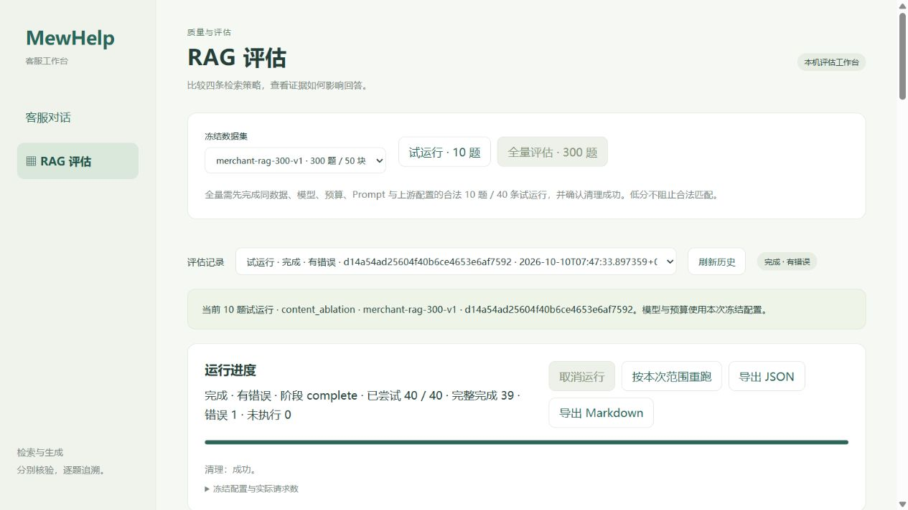
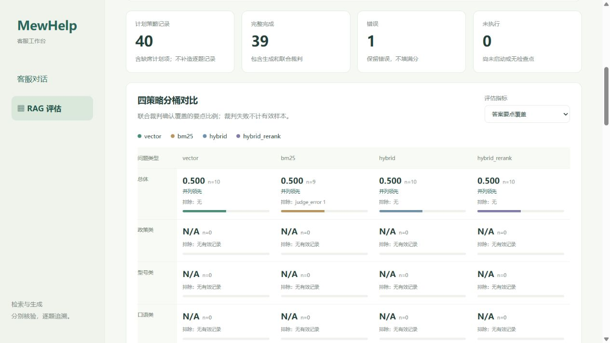
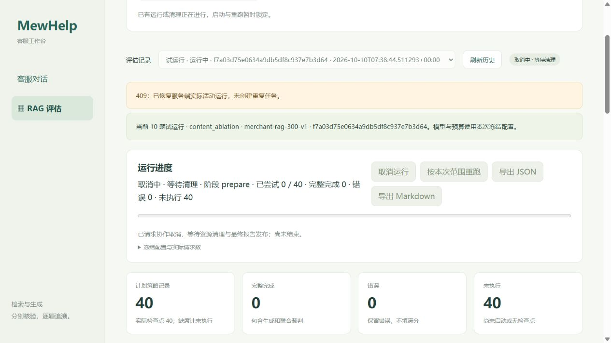
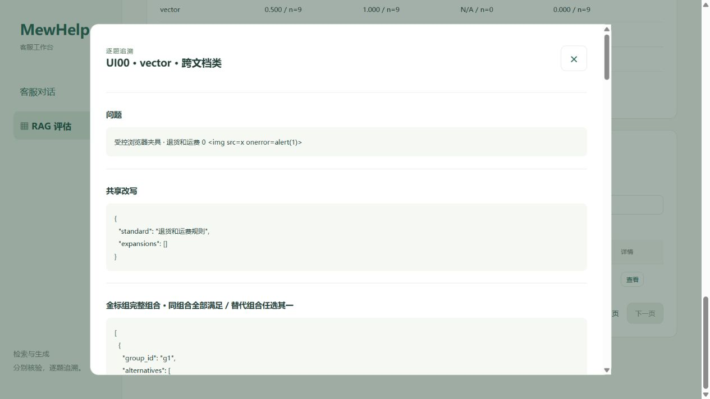
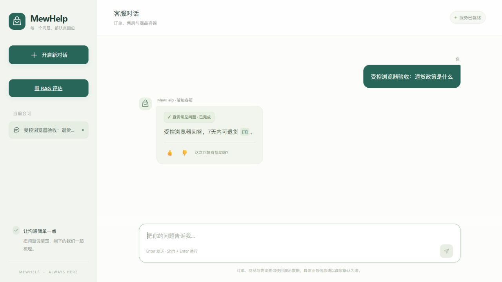

# RAG 工作台前端验收

2026-10-10，Task 9。正式入口为 `/rag-eval`，原 `/static/rag-evaluation.html` 保持可访问。聊天页侧栏增加工作台入口。

## 验收环境与范围

浏览器为 Codex In-app Browser，使用启用的 cua_repl API。受控服务只绑定 `127.0.0.1:8019`，使用当前 `create_app`、Task 8 路由、实际 RunStore、公开投影与发布器。收费运行边界和聊天上游采用确定性夹具。记录保存在忽略目录 `.cache/task9-browser-store`，没有进入 `runtime/rag-evaluation`，没有数据库、Milvus或付费模型请求。

截图中的 UIxx 题号与分数全部为受控验收数据，不能证明正式模型质量或放行正式全量。夹具的 `pilot_ready` 调用真实只读门槛；其缺少新出处的记录不能放行全量。真实试运行、全量和真实分数由 Task 10 验收。

实现前读取两份完整 Context7 官方缓存 `context7-workbench-ui-polling.txt`、`context7-rag-admin-frontend-dom.txt`、研究归档及实际 HTTP/metric 接口。使用 createElement/textContent、原生 dialog 与 AbortController，不使用返回资料中混入的 setHTMLUnsafe。

## 浏览器结果

| 动作 | 实际结果 |
| --- | --- |
| 加载 datasets/history | 显示冻结 300 题 / 50 块、历史选择。全量按钮禁用，说明同数据/模型/预算/Prompt/上游配置合法 10 题 / 40 条及清理成功的要求。 |
| 首次试运行产生真实 HTTP 409 | 读取实际历史，恢复 run `f7a03d75e0634a9db5df8c937e7b3d64`，显示运行阶段和计划分母；只发一次启动 POST。 |
| 取消 | cancel POST 200，先显示 cancelling/等待清理，启动和取消按钮锁定；3 秒夹具清理结束后 GET 观察 cancelled，启动解锁。最终代码再次用 `838656925e9a4b3d811ff8e4198ed417` 验收同一流程。 |
| 202 启动、初始化失败 | run `19d3ab3b3c054174a16a1f1556d461a7` 先运行后 failed。计划 40、未执行 40、实际 cases=0；指标 N/A，显示公共 prepare_failed 错误和清理成功。 |
| 按本次范围重跑 | 发出单次 202 POST，创建新 run `b2316fd6fa764512b83bfa28c845b8f3`；随后切换聊天页，日志无后续该 run 的轮询，夹具独立结束为 failed。 |
| GET 轮询 | 读取完成后间隔 2 秒再调度，不重叠；取消先失效旧轮询版本；终态停止。pagehide 清定时器、中止请求、失效响应令牌；过期回调在发请求前退出。 |
| 分页 | 40 条记录每页 20 条，第 2 页首题为 UI05；过滤后重新回第 1 页。 |
| 组合筛选 | bm25 + judge_error + UI09 返回恰好 1 条；所有分页、筛选与单题详情均为 GET，不执行模型。 |
| 完整详情 | 展示 g1 的 AND [1,2] / OR [3] 与 g2 [4]；候选/最终 [1,2,4]，Prompt 实际仅 [1,4]，Prompt组覆盖 0.5。300 次重复证据及“原文结尾标记”完整保留。 |
| 要点、断言、错误 | UI00 显示 p1 已覆盖、p2 遗漏、全部断言及理由；UI09 bm25 显示 judge_error 和安全公共错误，裁判要点/断言 N/A。 |
| 文本安全、焦点 | 题面中的 img/onerror 和聊天来源中的 script 都显示为文字，详情 img 节点数 0。关闭详情与聊天来源均恢复触发按钮焦点。 |
| 指标切换、并列 | 全部 11 个 v2 指标可选。要点覆盖四路均 0.500 全部标“并列领先”；bm25 n=9、其余 n=10，显示 judge_error 排除 1。误拒答率按低值领先。 |
| 共同子集 | 单列四路均 completed 的 9 题，四路要点 n=9。库外拒答 N/A/n=0；不把共同子集当完整全量。 |
| v1 只读 | 新指标 N/A/n=N/A，共同子集 N/A，旧重跑禁用；另选明确的历史 MRR 显示原 0.972/0.854/0.944/0.972，原 n=24，两个并列领先。旧语料与额外重排门槛明确提示。 |
| JSON 导出 | 浏览器取得实际文件 `fabcb7b334e045ecab74726a1ae1b7d6.json`，326539 字节，40 records，共同子集 9，实际 request_counts 全 0。SHA256 `862bed611e535f6748864945e2b87993c6a751d3ea7dd6a1812e6acba6fcef47`。 |
| Markdown 导出 | 浏览器按钮实际 GET 200；另用只读 HTTP 核验为 text/markdown、371173 字节，完整尾标记存在、私密 PRIVATE-JUDGE 不存在。未观察到浏览器本机 .md 保存文件，不将它宣称为已保存下载。 |
| 聊天回归 | 实际 create_app 与确定性 query_faq/模型产生 SSE、本轮 [1] 来源、纯文本原文；第一轮 👍、第二轮 👎 选择后两按钮均禁用，日志没有反馈 HTTP 请求。聊天 JS 未修改。 |
| 控制台 | 最终浏览器 `dev.logs({levels:["error","warn"],limit:50})` 返回 `[]`。 |

## 截图

所有图片都是上述受控数据。概览与指标截图为最终页面；详情、取消、失败与聊天截图为对应验收状态。







另存 `rag-ui-busy.jpg`、`rag-ui-failure.jpg`、`rag-ui-detail.jpg`、`rag-ui-legacy.jpg`、`rag-ui-chat-feedback.jpg`。

## 最终命令与限制

```powershell
& D:/vue/node.exe --check app/static/rag-evaluation.js
& D:/vue/node.exe --check app/static/chat.js
git diff --check
```

三项退出均为 0。diff 仅有既存 Windows LF/CRLF 提示。用户本次前端例外不写 TDD、不安排独立审查；没有后端改动、merge 或 push。

原始请求日志在 `.cache/task9-browser-out.log`、`task9-browser-out2.log`，启动诊断在对应 err 日志。辅助启动使用 Start-Process -WindowStyle Hidden；初次有效进程 launcher51424/child100376，修正聊天夹具后 launcher34704/child19648。均仅由本人按记录 PID 停止，最终19648/34704 alive=False；8019不再运行。固定 store 保留在.cache用于审计，不注册为正式pilot。既有8001/health保持200；8000/health只读检查返回HttpRequestException，未触碰其进程。默认沙箱启动曾阻塞而取消，窄范围隔离夹具启动提升获准，无自动审批拒绝。
